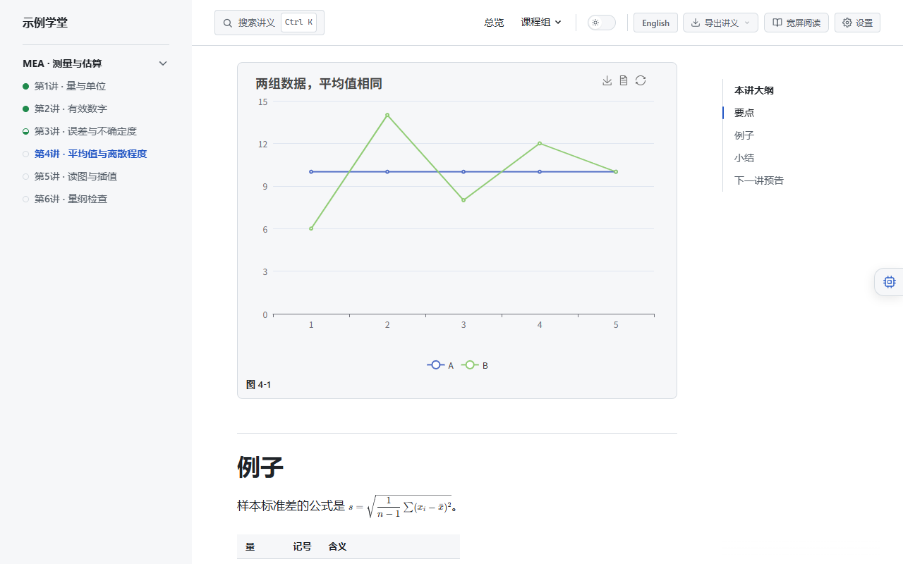

# Interactive Lecture Engine

**Language**: [中文](./README.md) · English

An engine that turns engineering lecture notes into a static website. Lectures are written in Markdown and can hold
interactive charts and formulas; the prerequisites between courses are drawn as a map you can pan and zoom; a reader's
progress is kept in the browser. An optional backend, `lecture-api`, adds progress sync across devices, sign-in through
a gateway and the AI reading companion.

The site is built on VitePress 1.6 and Vue 3, the backend on Node.js and Hono, mostly in TypeScript.

> This is V2, a rewrite: the folder layout, the configuration files and where content lives all differ from V1, so a V1
> checkout cannot be upgraded in place. The V1 code stays in the history of `main` before V2.

The interface is Chinese and English; the screenshots below show the Chinese interface.

## Screenshots

Taken from the example content that ships with the engine (`npm run screenshots:readme`).

| | |
|---|---|
|  |  |
| Course atlas, reader theme, light | The same page, datasheet theme, dark |
|  |  |
| Group page: lectures, progress and the group map | Lecture page: a chart and a formula |
|  |  |
| Site-wide prerequisite canvas | Concept page |
|  |  |
| AI companion sidebar | Dashboard overview |

<p align="center"><br>A lecture on a phone (390 px)</p>

## Features

**Lectures**

- Markdown with frontmatter. Formulas are rendered with KaTeX at build time, code blocks are highlighted with Shiki.
- Charts: a placeholder in the lecture, the data in `charts/<lecture>.json`; ECharts, Mermaid and WaveDrom.
- Figure packs: images managed per course group, numbered and cross-referenced. `scripts/figures/import_figure.py`
  crops figures out of paper PDFs and registers them.
- Concept pages: stand-alone entries. Concept links in a lecture show a card on hover; relations between concepts have
  their own graph.

**Navigation and progress**

- Course atlas on the home page: zones per category, pan and zoom.
- Site-wide prerequisite canvas, laid out with ELK.
- Group pages: the lectures, the group's progress and a map of the group.
- Course menu in the sidebar and full-text search.
- Progress per lecture (not started, in progress, done), kept in the browser and synced per user when a backend is there.

**Interface**

- Two theme packs: reader (the default, system fonts only) and datasheet, each light and dark. A theme can replace some
  interface components (slots); third-party packs can be installed.
- Chinese and English interface. Lectures can have English translations; a lecture without one says so.
- Lectures export to PDF and long images. This needs a headless Chromium (`npm run pregen:setup`), not installed by default.

**Access control**

- Each course group has an access tier: public, signed-in users, or named user groups.
- The build keeps restricted content (titles, text, chart data, search index) out of the public files and writes a
  gateway manifest for nginx. The reader's identity comes from a gateway in front (for example Authelia) as request headers.

**AI companion (optional)**

- A chat sidebar on lecture pages with quick actions: explain this passage, give an example, make a self-test question,
  summarise this section. Quick actions and prompts are edited in the Dashboard.
- Online, `lecture-api` forwards to an OpenAI-compatible model API with a per-user limit per minute and per day; readers
  can also enter their own key in the browser.
- The model can call five engine tools on the site's content: concept search, concept details, concept graph, lecture
  search, lecture summary. The same tools are offered to external agents as an MCP server (`/api/mcp`, token required).
- On the local dev server an author can let the model draft a new concept page or add to an existing one; names and
  links are checked before anything is written.

**Dashboard**

- `/dashboard`: content check results, site texts, companion prompts and quick actions, course groups and access tiers,
  themes, runtime state and terminal log.
- Editing works only on the local dev server, from the same machine with the dev token; a deployed site shows it read-only.

**Content kept apart from the engine**

- Lectures live in a separate content folder, `content/` (best as its own git repository); the engine repository ignores it.
- `npm run init` creates the folder from a template; `new:group` and `new:lecture` write skeletons; `check:content`
  checks the lecture contract.
- Rules for coding agents (Claude Code, Kiro and others) are in [`AGENTS.md`](./AGENTS.md).

## Quick start

Node.js 20 or newer and npm. Some helper scripts (lecture checks, figure import) need Python 3.

```bash
git clone <this repository's URL>
cd Interactive-Lecture-Engine/site
npm ci
npm run dev        # without content/ it shows the engine's example content
```

Your own content:

```bash
npm run init                                                    # creates content/ at the repository root
npm run new:group -- --id G01 --dir g01 --title "First course"
npm run new:lecture -- --group G01 --title "First lecture"
npm run check:content
npm run build                                                   # output in site/docs/.vitepress/dist
```

`npm run init` leaves the site texts (`content/site-texts.json`) empty. Fill in at least the site name (`name`, in both
languages) before a build, in the file or on the Dashboard page for site texts.

How to write content: [docs/authoring/](docs/authoring/README.md).

## Backend: lecture-api (optional)

A static site needs no backend. Deploy it for progress across devices, sign-in, or the AI companion online:

- Node.js 20+, Hono;
- PostgreSQL, or the built-in PGlite (one machine, no database server);
- behind nginx and a sign-in gateway that passes the user's identity.

See [server/README.md](server/README.md); deployment, gateway, backups and upgrades are in [docs-dev/](docs-dev/).

## Layout

```text
site/        the VitePress site: themes, components, build plugins, checks, tests
server/      lecture-api (optional)
templates/   the template of a new content folder
docs/        authoring/ content rules, lecture contract and recipes; backend-handoff/ API contracts; screenshots/
docs-dev/    maintainer documentation
scripts/     lecture checks, deployment helpers, graph importers, privacy scan
```

## Documentation

| Document | About |
|---|---|
| [docs/authoring/](docs/authoring/README.md) | Writing content: lecture contract, new groups and lectures, figure packs, graphs, site texts, access tiers |
| [docs-dev/CONFIG.md](docs-dev/CONFIG.md) | Configuration files, precedence, `npm run setup` and `npm run doctor` |
| [docs-dev/BUILD.md](docs-dev/BUILD.md) | Build pipeline and memory |
| [docs-dev/ACCESS.md](docs-dev/ACCESS.md) | Access tiers in the build, gateway manifest |
| [docs-dev/MAP.md](docs-dev/MAP.md), [GROUP.md](docs-dev/GROUP.md) | Course atlas, dependency canvas, group page |
| [docs-dev/SLOTS.md](docs-dev/SLOTS.md) | Theme packs and component slots |
| [docs-dev/I18N.md](docs-dev/I18N.md) | Languages |
| [docs-dev/PROGRESS.md](docs-dev/PROGRESS.md) | Reading progress |
| [docs-dev/CONCEPTS.md](docs-dev/CONCEPTS.md) | Concept drafting and companion tool calls |
| [docs-dev/FIGURES.md](docs-dev/FIGURES.md) | Figure packs |
| [docs-dev/DEBUGGING.md](docs-dev/DEBUGGING.md) | Front-end debugging: API mode and the browser debug console |
| [docs-dev/DEPLOY.md](docs-dev/DEPLOY.md), [GATEWAY.md](docs-dev/GATEWAY.md), [BACKUP.md](docs-dev/BACKUP.md), [UPGRADE.md](docs-dev/UPGRADE.md) | Deployment, gateway, backups, upgrades and rollback |

Some maintainer pages are in Chinese.

## Development and tests

```bash
cd site
npm run check        # type checks, lint, theme contract, unit tests, content check
npm run test:e2e     # Playwright browser tests on the engine's example content
cd ../server
npm test             # backend tests
```

Privacy check before commits: `node scripts/privacy/install-hook.mjs` installs a pre-commit hook that stops local paths,
e-mail addresses, key-shaped strings and files from the content folder. CI runs the same scan.

Contributing: [CONTRIBUTING.md](./CONTRIBUTING.md). Security reports: [SECURITY.md](./SECURITY.md).

## Known limits

- The interface is in Chinese and English only.
- The Dashboard edits only on the local dev server. A few items (reader usage, backup list) have no backend endpoint yet
  and show as unavailable.
- PDF and long-image export downloads a headless Chromium; it is not installed by default.
- Large sites take a lot of memory to build: about 6 GB at peak for some 450 pages; see [BUILD.md](docs-dev/BUILD.md) for
  small hosts.
- The AI companion needs an OpenAI-compatible model API, paid for by whoever deploys the site.

## License

[MIT](./LICENSE)
