<div align="center">

<picture><source media="(prefers-color-scheme: dark)" srcset="docs/brand/banner-dark.svg">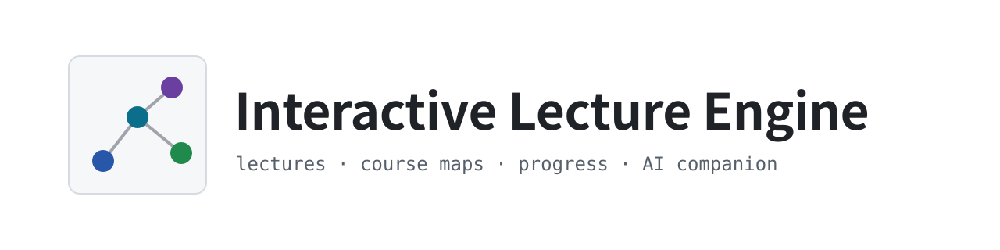</picture>

<h3>Turn engineering lecture notes into an interactive static website</h3>

<p>Write lectures in Markdown; charts, formulas, prerequisite maps, reading progress and an AI companion come built in</p>

     

<p>[中文](./README.md) · **English**</p>

<p>[Highlights](#highlights) · [Screenshots](#screenshots) · [Quick start](#quick-start) · [How it works](#how-it-works) · [Features](#features) · [Docs](#documentation)</p>

</div>

<br>

<p align="center"><picture><source media="(prefers-color-scheme: dark)" srcset="docs/brand/hero-dark.png">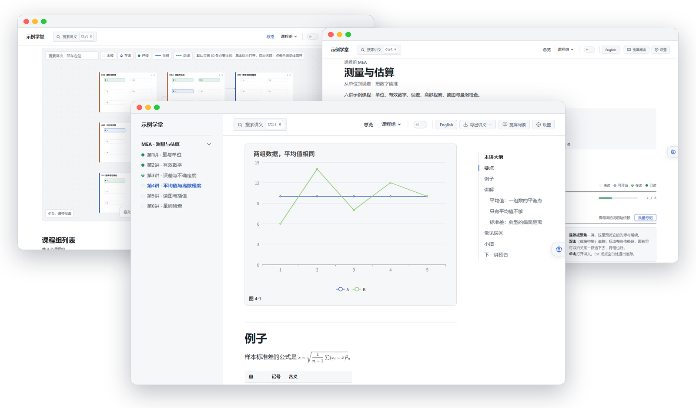</picture></p>

<p align="center"><sub>The dependency canvas, a group page and a lecture. Every screenshot shows the demo content that ships with the engine (Chinese interface); this README takes its colours from the engine's themes: reader in light mode, datasheet in dark mode.</sub></p>

> [!IMPORTANT]
> This is V2, a rewrite: the folder layout, the configuration files and where content lives all differ from V1, so a V1 checkout cannot be upgraded in place. The V1 code stays in the history of `main` before V2.

## Highlights

<p align="center"><picture><source media="(prefers-color-scheme: dark)" srcset="docs/brand/highlights-en-dark.svg">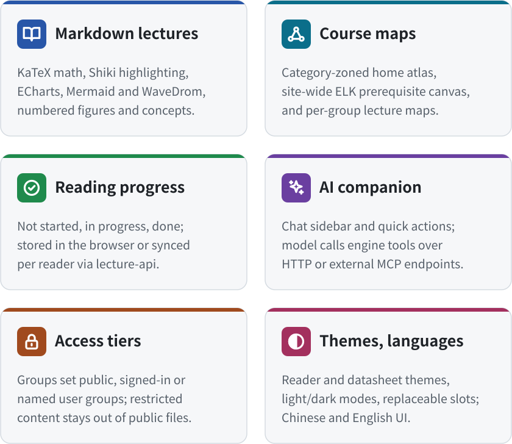</picture></p>

## Screenshots

<table>
<tr>
<td width="50%"></td>
<td width="50%">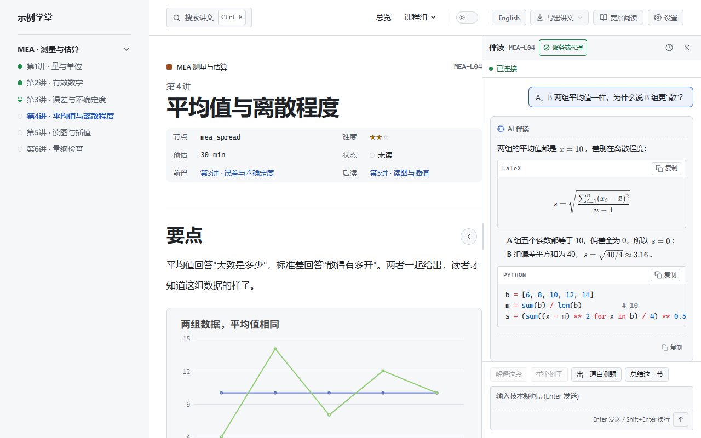</td>
</tr>
<tr>
<td align="center"><sub>A lecture: interactive chart and formulas</sub></td>
<td align="center"><sub>The AI companion: formulas and highlighted code</sub></td>
</tr>
</table>

<details>
<summary><b>More screenshots</b>: course atlas (both themes), group page, dependency canvas, concept card, Dashboard, phone</summary>
<br>

<table>
<tr>
<td width="50%">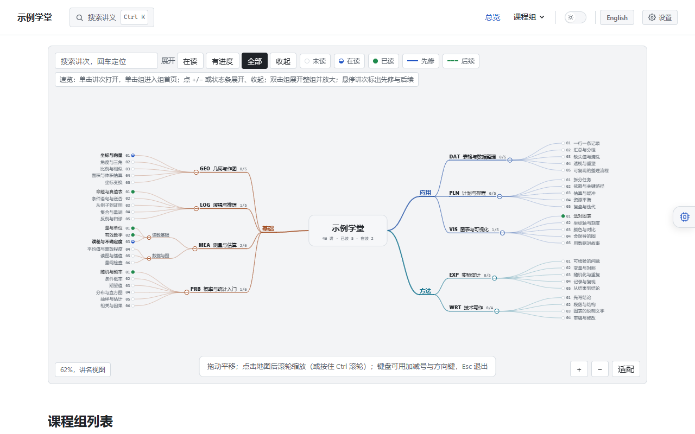<br><sub>Course atlas, reader theme, light</sub></td>
<td width="50%">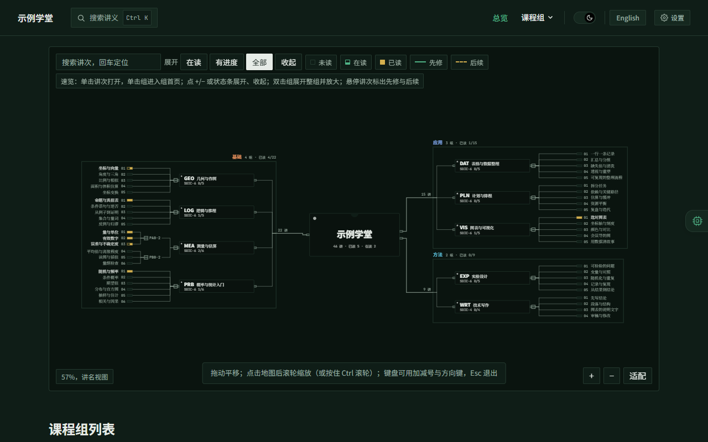<br><sub>The same page, datasheet theme, dark</sub></td>
</tr>
<tr>
<td width="50%">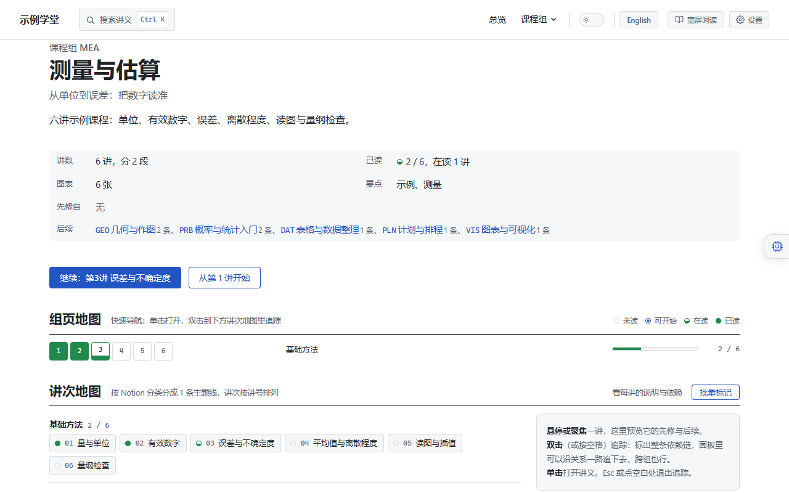<br><sub>Group page: lectures, progress and the group map</sub></td>
<td width="50%">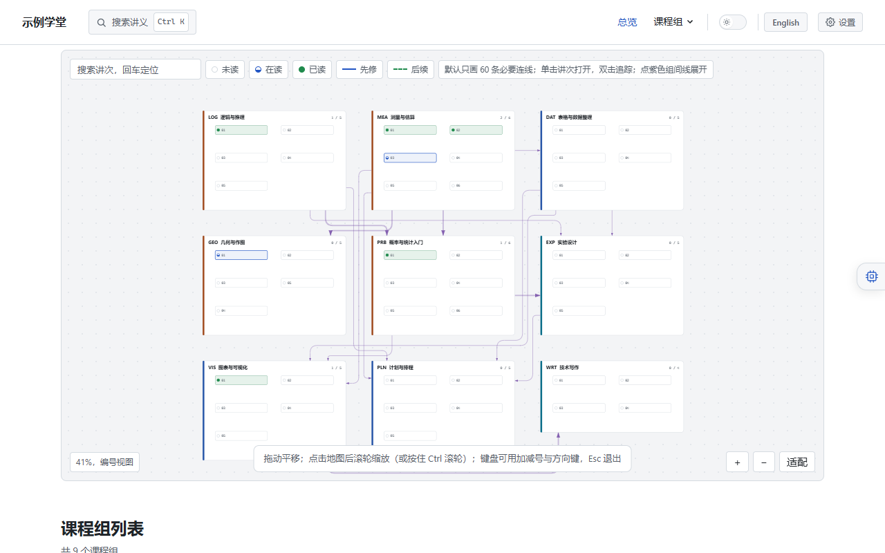<br><sub>Site-wide prerequisite canvas</sub></td>
</tr>
<tr>
<td width="50%">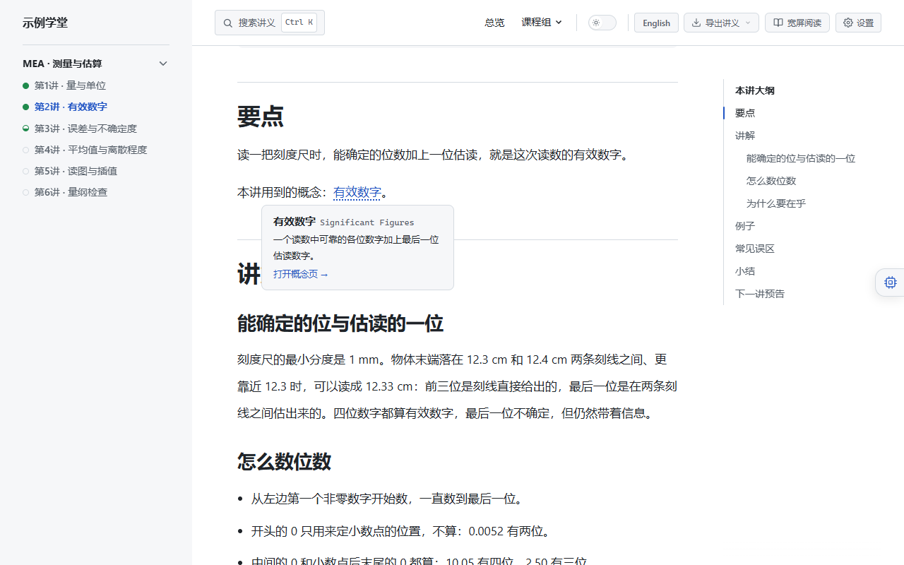<br><sub>A concept card in a lecture</sub></td>
<td width="50%">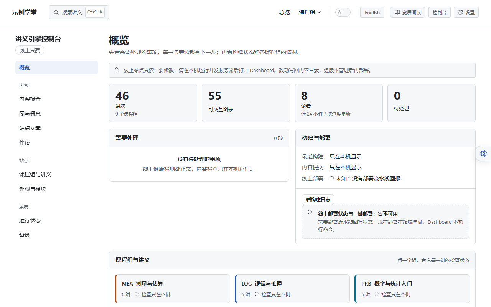<br><sub>Dashboard overview</sub></td>
</tr>
</table>

<p align="center">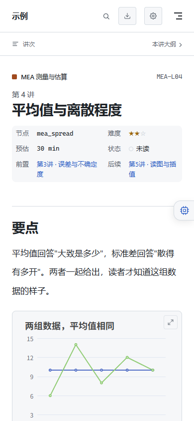<br><sub>A lecture on a phone (390 px)</sub></p>

</details>

## Quick start

You need Node.js 20 or later and npm; a few helper scripts (lecture checks, figure import) need Python 3.

### <picture><source media="(prefers-color-scheme: dark)" srcset="docs/brand/icons/step-1-dark.svg"></picture>&nbsp; Run the demo site

```bash
git clone <this repository's URL>
cd Interactive-Lecture-Engine/site
npm ci
npm run dev        # without content/ the engine shows its own demo content
```

### <picture><source media="(prefers-color-scheme: dark)" srcset="docs/brand/icons/step-2-dark.svg"></picture>&nbsp; Create your own content

```bash
npm run init                                          # creates content/ at the repository root
npm run new:group -- --id G01 --dir g01 --title "First course"
npm run new:lecture -- --group G01 --title "First lecture"
npm run check:content
```

> [!TIP]
> The site texts `npm run init` creates (`content/site-texts.json`) are empty; fill in at least the site name (`name`) in Chinese and English before building, or do it on the Dashboard's site texts page.

### <picture><source media="(prefers-color-scheme: dark)" srcset="docs/brand/icons/step-3-dark.svg"></picture>&nbsp; Build and publish

```bash
npm run build      # writes site/docs/.vitepress/dist, ready for any static host
```

How to write content: [docs/authoring/](docs/authoring/README.md).

## How it works

<p align="center"><picture><source media="(prefers-color-scheme: dark)" srcset="docs/brand/architecture-en-dark.svg">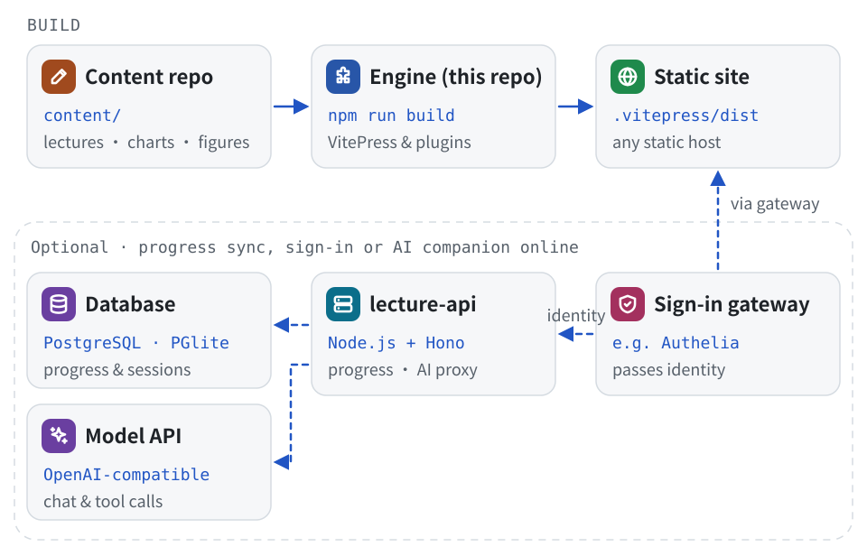</picture></p>

<p align="center"><sub>A static site alone needs nothing inside the dashed frame.</sub></p>

## Features

<details>
<summary><picture><source media="(prefers-color-scheme: dark)" srcset="docs/brand/icons/lecture-dark.svg"></picture>&nbsp; <b>Lectures</b> · Markdown, formulas, charts, figure packs, concept pages</summary>

- Markdown with frontmatter. Formulas are rendered with KaTeX at build time, code blocks are highlighted with Shiki.
- Charts: a placeholder in the lecture, the data in `charts/<lecture>.json`; ECharts, Mermaid and WaveDrom.
- Figure packs: images managed per course group, numbered and cross-referenced. `scripts/figures/import_figure.py` imports figures cropped from paper PDFs.
- Concept pages: stand-alone concept entries. Concept links in a lecture show a card on hover; the relations between concepts have their own graph.

</details>

<details>
<summary><picture><source media="(prefers-color-scheme: dark)" srcset="docs/brand/icons/map-dark.svg"></picture>&nbsp; <b>Navigation and progress</b> · course atlas, dependency canvas, group pages, search, reading progress</summary>

- The course atlas on the home page: zones per category, zoom and pan.
- The site-wide prerequisite canvas, laid out with ELK.
- Group pages: the lectures, the group's progress and its map.
- A course menu in the sidebar and full-text search.
- Reading progress in three states, not started, in progress and done, kept in the browser; with the backend it is kept per reader.

</details>

<details>
<summary><picture><source media="(prefers-color-scheme: dark)" srcset="docs/brand/icons/theme-dark.svg"></picture>&nbsp; <b>Interface</b> · two theme packs, component slots, Chinese and English, PDF export</summary>

- Two theme packs: reader (the default, system fonts only) and datasheet, each light and dark. A theme can replace some interface components (slots); third-party theme packs can be installed.
- The interface is Chinese and English. Lectures can have English translations; untranslated lectures say so.
- Lectures can be exported as PDF and long images. This needs a headless Chromium (`npm run pregen:setup`), not installed by default.

</details>

<details>
<summary><picture><source media="(prefers-color-scheme: dark)" srcset="docs/brand/icons/access-dark.svg"></picture>&nbsp; <b>Access control</b> · tiers per course group, restricted content kept out of public files</summary>

- Every course group can have an access tier: public, signed-in readers, or named user groups.
- At build time restricted content (titles, text, chart data, search index) stays out of the public files, and a gateway manifest for nginx is written. The reader's identity reaches the site and the backend from a gateway in front (e.g. Authelia) through request headers.

</details>

<details>
<summary><picture><source media="(prefers-color-scheme: dark)" srcset="docs/brand/icons/ai-dark.svg"></picture>&nbsp; <b>AI companion (optional)</b> · chat sidebar, quick actions, engine tools and MCP</summary>

- A chat sidebar on lecture pages with quick actions: explain this, give an example, make a self-test question, summarise this section. Quick actions and prompts can be edited on the Dashboard.
- Formulas in answers are typeset with KaTeX and code blocks are highlighted; the model's output is sanitized first, and the formulas and highlighting go in afterwards.
- Online, `lecture-api` forwards to an OpenAI-compatible model API with per-reader limits per minute and per day; readers can also enter their own key in the browser and call the model directly.
- The model can call 5 engine tools to look things up on the site: concept search, concept details, concept graph, lecture search, lecture summary. The same tools are served to outside agents over MCP (`/api/mcp`, token required).
- On the local dev server, authors can have the model draft a new concept page or extend an existing one; names and links are checked before anything is written.

</details>

<details>
<summary><picture><source media="(prefers-color-scheme: dark)" srcset="docs/brand/icons/layers-dark.svg"></picture>&nbsp; <b>Dashboard</b> · content checks, site texts, prompts, course groups, status</summary>

- The `/dashboard` page: content check results, site texts, companion prompts and quick actions, course groups and access tiers, themes, run status and the terminal log.
- Editing works only on the local dev server, from the same machine and with the dev token; a deployed site is read-only.

</details>

<details>
<summary><picture><source media="(prefers-color-scheme: dark)" srcset="docs/brand/icons/pen-dark.svg"></picture>&nbsp; <b>Content kept apart from the engine</b> · a content folder of its own, scaffolding and contract checks</summary>

- Lectures live in a separate content folder, `content/` (best kept as a git repository of its own); the engine repository ignores it.
- `npm run init` creates the content folder from the template; `new:group` and `new:lecture` create skeletons; `check:content` checks against the lecture contract.
- The rules for coding agents (Claude Code, Kiro, …) are in [`AGENTS.md`](./AGENTS.md).

</details>

## Backend: lecture-api (optional)

A static site needs no backend. Deploy it when you want progress across devices, sign-in identities or the AI companion online.

<table>
<tr>
<td width="190"><picture><source media="(prefers-color-scheme: dark)" srcset="docs/brand/icons/server-dark.svg"></picture>&nbsp; <b>Runtime</b></td>
<td>Node.js 20+, Hono</td>
</tr>
<tr>
<td width="190"><picture><source media="(prefers-color-scheme: dark)" srcset="docs/brand/icons/database-dark.svg"></picture>&nbsp; <b>Database</b></td>
<td>PostgreSQL, or the built-in PGlite (single machine, no dependencies)</td>
</tr>
<tr>
<td width="190"><picture><source media="(prefers-color-scheme: dark)" srcset="docs/brand/icons/gateway-dark.svg"></picture>&nbsp; <b>Deployment</b></td>
<td>behind nginx and a sign-in gateway that passes the reader's identity</td>
</tr>
</table>

See [server/README.md](server/README.md); deployment, gateway, backups and upgrades are in [docs-dev/](docs-dev/).

## Documentation

<table>
<tr>
<th width="33%" align="left"><picture><source media="(prefers-color-scheme: dark)" srcset="docs/brand/icons/pen-dark.svg"></picture>&nbsp; Writing content</th>
<th width="33%" align="left"><picture><source media="(prefers-color-scheme: dark)" srcset="docs/brand/icons/puzzle-dark.svg"></picture>&nbsp; Features</th>
<th width="33%" align="left"><picture><source media="(prefers-color-scheme: dark)" srcset="docs/brand/icons/rocket-dark.svg"></picture>&nbsp; Deployment and operations</th>
</tr>
<tr>
<td valign="top">

<a href="docs/authoring/README.md">Authoring guide</a><br><sub>lecture contract, groups, figures, graph, site texts, access</sub><br>
<a href="docs-dev/FIGURES.md">Figure packs</a><br><sub>numbering, cross-references, import from PDF</sub><br>
<a href="docs-dev/CONCEPTS.md">Concept pages and companion tools</a><br><sub>drafting concepts, tool calls</sub>

</td>
<td valign="top">

<a href="docs-dev/MAP.md">Course maps and canvas</a><br>
<a href="docs-dev/GROUP.md">Group pages</a><br>
<a href="docs-dev/SLOTS.md">Theme packs and slots</a><br>
<a href="docs-dev/I18N.md">Languages</a><br>
<a href="docs-dev/PROGRESS.md">Reading progress</a><br>
<a href="docs-dev/ACCESS.md">Access tiers</a><br>
<a href="docs-dev/DEBUGGING.md">Frontend debugging</a>

</td>
<td valign="top">

<a href="docs-dev/CONFIG.md">Configuration</a><br><sub>setup and doctor</sub><br>
<a href="docs-dev/BUILD.md">Build and tests</a><br>
<a href="docs-dev/DEPLOY.md">Deploy</a><br>
<a href="docs-dev/GATEWAY.md">Gateway</a><br>
<a href="docs-dev/BACKUP.md">Backups</a><br>
<a href="docs-dev/UPGRADE.md">Upgrades</a><br>
<a href="server/README.md">Backend</a>

</td>
</tr>
</table>

## Layout

```text
site/        the VitePress site: theme, components, build plugins, check scripts, tests
server/      the lecture-api backend (optional)
templates/   the template of a new content folder and the demo content
docs/        authoring/ how to write content; backend-handoff/ the frontend-backend contract; screenshots/, brand/ the pictures above
docs-dev/    maintainer documentation
scripts/     lecture checks, deployment helpers, graph import, privacy scan
```

## Development and tests

```bash
cd site
npm run check        # type check, lint, theme contract, unit tests, content check
npm run test:e2e     # Playwright browser tests, on the engine's demo content
cd ../server
npm test             # backend tests
```

Privacy check before a commit: `node scripts/privacy/install-hook.mjs` installs a pre-commit hook that stops local paths, e-mail addresses, strings shaped like keys and files of the content folder. CI runs the same scan.

## Known limits

> [!NOTE]
> - The interface is in Chinese and English only.
> - The Dashboard can only edit on the local dev server. A few items (reader usage, backup list) have no backend endpoint yet and are marked as unavailable.
> - PDF and long-image export downloads a headless Chromium, not installed by default.
> - Large sites need a lot of memory to build: about 6 GB at the peak for about 450 pages; for small hosts see [BUILD.md](docs-dev/BUILD.md).
> - The AI companion needs an OpenAI-compatible model API, paid for by whoever deploys it.

## Contributing

Issues and pull requests are welcome, see [CONTRIBUTING.md](./CONTRIBUTING.md); report security problems privately as described in [SECURITY.md](./SECURITY.md); community rules are in [CODE_OF_CONDUCT.en.md](./CODE_OF_CONDUCT.en.md).

<br>
<div align="center"><sub>Released under the <a href="./LICENSE">MIT</a> license</sub></div>
