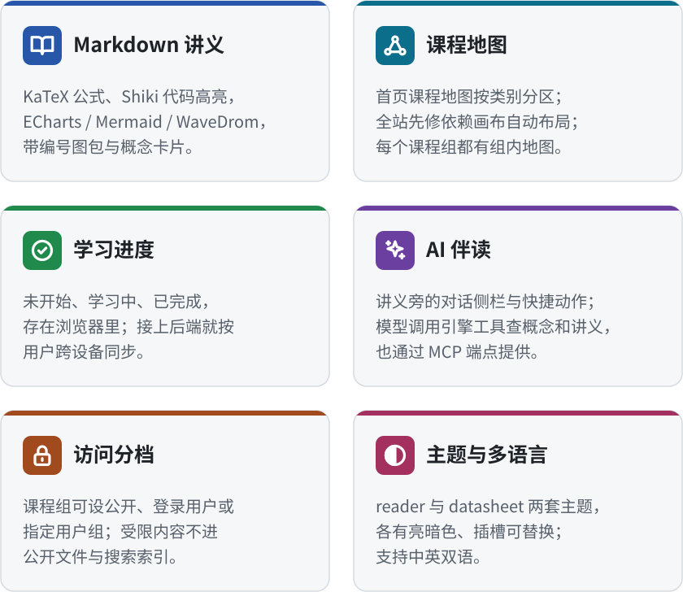
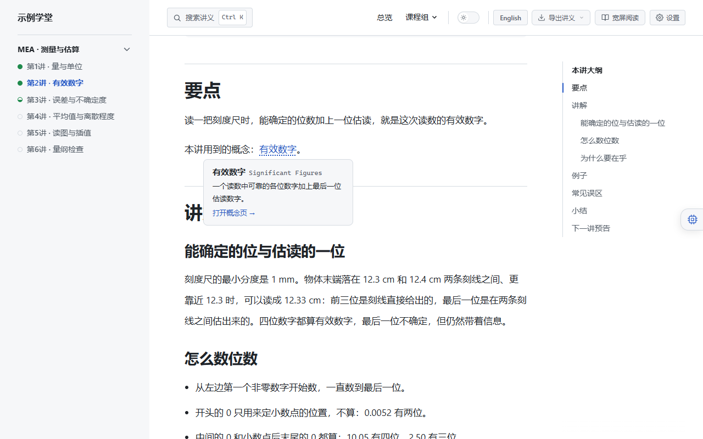
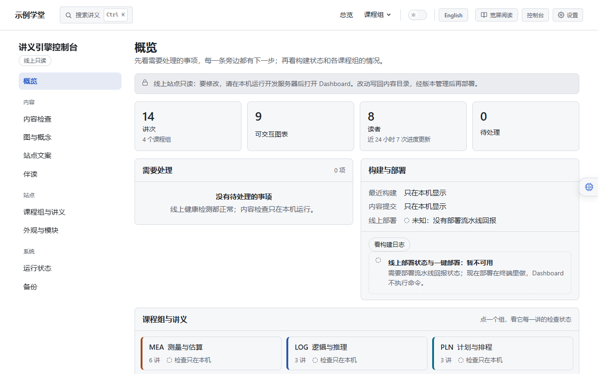
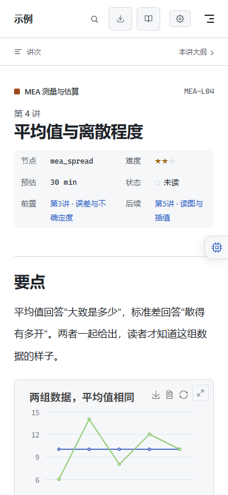
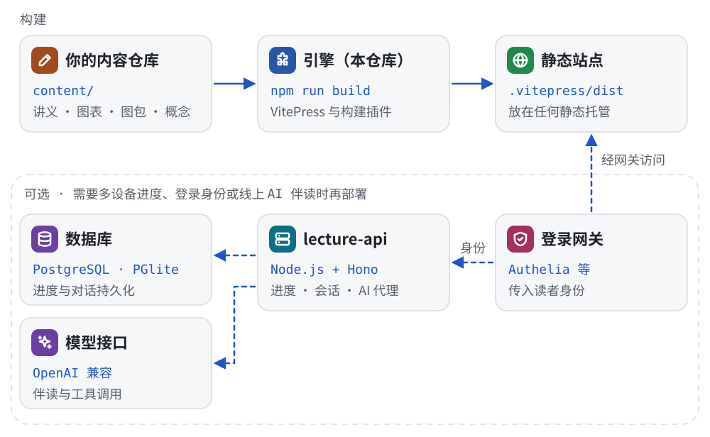

<div align="center">

<picture><source media="(prefers-color-scheme: dark)" srcset="docs/brand/banner-dark.svg"></picture>

<h3>把工程类讲义做成可交互的静态网站</h3>

<p>Markdown 写讲义，图表、公式、先修地图、学习进度和 AI 伴读开箱即用</p>

     

<p><b>中文</b> · <a href="./README.en.md">English</a></p>

<p><a href="#亮点">亮点</a> · <a href="#截图">截图</a> · <a href="#快速开始">快速开始</a> · <a href="#工作方式">工作方式</a> · <a href="#功能">功能</a> · <a href="#文档">文档</a></p>

</div>

<br>

<p align="center"><picture><source media="(prefers-color-scheme: dark)" srcset="docs/brand/hero-dark.png"></picture></p>

<p align="center"><sub>依赖画布、课程组页和讲义页。所有截图都来自引擎自带的示例内容；README 的配色取自引擎主题：亮色是 reader，暗色是 datasheet。</sub></p>

> [!IMPORTANT]
> 这是 V2，是一次重写：目录结构、配置文件和内容的放法都和 V1 不同，不能在 V1 的目录上直接升级。V1 的代码保留在 `main` 分支 V2 之前的历史提交里。

## 亮点

<p align="center"><picture><source media="(prefers-color-scheme: dark)" srcset="docs/brand/highlights-zh-dark.svg"></picture></p>

## 截图

<table>
<tr>
<td width="50%"></td>
<td width="50%"></td>
</tr>
<tr>
<td align="center"><sub>讲义页：交互图表与公式</sub></td>
<td align="center"><sub>AI 伴读：公式与代码高亮</sub></td>
</tr>
</table>

<details>
<summary><b>更多截图</b>: 首页课程地图（两套主题）、课程组页、依赖画布、概念卡片、Dashboard、手机</summary>
<br>

<table>
<tr>
<td width="50%"><br><sub>首页课程地图，reader 主题亮色</sub></td>
<td width="50%"><br><sub>同一页，datasheet 主题暗色</sub></td>
</tr>
<tr>
<td width="50%"><br><sub>课程组页：讲义列表、进度和组内地图</sub></td>
<td width="50%"><br><sub>全站先修依赖画布</sub></td>
</tr>
<tr>
<td width="50%"><br><sub>讲义里的概念卡片</sub></td>
<td width="50%"><br><sub>Dashboard 概览</sub></td>
</tr>
</table>

<p align="center"><br><sub>手机上的讲义页（390 px）</sub></p>

</details>

## 快速开始

需要 Node.js 20 或更新版本和 npm；部分辅助脚本（讲义检查、图片入库）需要 Python 3。

### <picture><source media="(prefers-color-scheme: dark)" srcset="docs/brand/icons/step-1-dark.svg"></picture>&nbsp; 跑起示例站点

```bash
git clone <本仓库的地址>
cd Interactive-Lecture-Engine/site
npm ci
npm run dev        # 没有 content/ 时显示引擎自带的示例内容
```

### <picture><source media="(prefers-color-scheme: dark)" srcset="docs/brand/icons/step-2-dark.svg"></picture>&nbsp; 建自己的内容

```bash
npm run init                                          # 在仓库根目录建 content/
npm run new:group -- --id G01 --dir g01 --title "第一门课"
npm run new:lecture -- --group G01 --title "第一讲"
npm run check:content
```

> [!TIP]
> `npm run init` 建出的站点文案 `content/site-texts.json` 是空的，构建前至少要填中英文的站点名称（`name`），也可以在 Dashboard 的“站点文案”页里填。

### <picture><source media="(prefers-color-scheme: dark)" srcset="docs/brand/icons/step-3-dark.svg"></picture>&nbsp; 构建并发布

```bash
npm run build      # 输出到 site/docs/.vitepress/dist，任何静态托管都能放
```

写内容的规矩见 [docs/authoring/](docs/authoring/README.md)。

## 工作方式

<p align="center"><picture><source media="(prefers-color-scheme: dark)" srcset="docs/brand/architecture-zh-dark.svg"></picture></p>

<p align="center"><sub>只发布静态站点时，虚线框里的部分都可以不要。</sub></p>

## 功能

<details>
<summary><picture><source media="(prefers-color-scheme: dark)" srcset="docs/brand/icons/lecture-dark.svg"></picture>&nbsp; <b>讲义</b> · Markdown、公式、图表、图包、概念页</summary>

- Markdown 加 frontmatter。公式在构建时用 KaTeX 渲染，代码块用 Shiki 高亮。
- 图表：讲义里放占位，数据写在 `charts/<讲义>.json`，支持 ECharts、Mermaid 和 WaveDrom。
- 图包：按课程组管理的图片，带编号和交叉引用。`scripts/figures/import_figure.py` 可以从论文 PDF 截图入库。
- 概念页：独立的概念条目。讲义里的概念链接悬停时显示卡片，概念之间的关系另有关系图。

</details>

<details>
<summary><picture><source media="(prefers-color-scheme: dark)" srcset="docs/brand/icons/map-dark.svg"></picture>&nbsp; <b>导航与进度</b> · 课程地图、依赖画布、课程组页、搜索、学习进度</summary>

- 首页课程地图：按类别分区，可以缩放和平移。
- 全站先修依赖画布：用 ELK 自动布局。
- 课程组页：讲义列表、本组进度和组内地图。
- 侧栏课程菜单和全文搜索。
- 学习进度分未开始、学习中、已完成三种，存在浏览器里；接了后端就按用户同步。

</details>

<details>
<summary><picture><source media="(prefers-color-scheme: dark)" srcset="docs/brand/icons/theme-dark.svg"></picture>&nbsp; <b>界面</b> · 两套主题包、组件插槽、中英双语、导出 PDF</summary>

- 两套主题包：reader（默认，只用系统字体）和 datasheet，各有亮色和暗色。主题可以替换部分界面组件（插槽），也可以安装第三方主题包。
- 界面有中文和英文两种语言。讲义可以有英文译本，没有译本的讲义会标明。
- 讲义可以导出 PDF 和长图。这一项要另外安装无头 Chromium（`npm run pregen:setup`），默认不装。

</details>

<details>
<summary><picture><source media="(prefers-color-scheme: dark)" srcset="docs/brand/icons/access-dark.svg"></picture>&nbsp; <b>访问控制</b> · 按课程组分档，受限内容不进公开文件</summary>

- 每个课程组可以设访问档：公开、登录用户、指定的用户组。
- 构建时受限内容（标题、正文、图表数据、搜索索引）不进公开文件，同时生成给 nginx 用的网关清单。读者身份可由内置账号（邮箱密码或 Passkey）、前置网关（例如 Authelia）通过请求头传入，或两者混合（`hybrid`）。

</details>

<details>
<summary><picture><source media="(prefers-color-scheme: dark)" srcset="docs/brand/icons/ai-dark.svg"></picture>&nbsp; <b>AI 伴读（可选）</b> · 对话侧栏、快捷动作、引擎工具与 MCP</summary>

- 讲义页侧栏对话，带快捷动作：解释这段、举个例子、出一道自测题、总结这一节。快捷动作和提示词都可以在 Dashboard 里改。
- 回答里的公式用 KaTeX 排版、代码块带语法高亮；模型输出先经安全过滤，再填入公式和高亮结果。
- 线上经 `lecture-api` 转发到 OpenAI 兼容的模型接口，按用户限制每分钟次数和每日次数；也可以让读者在浏览器里填自己的密钥直接调用。
- 模型可以调用 5 个引擎工具查站内内容：概念搜索、概念详情、概念关系图、讲义搜索、讲义摘要。同一组工具也以 MCP 服务（`/api/mcp`，需要令牌）提供给外部智能体。
- 在本机开发服务器上，作者可以让模型起草新的概念页或补充已有概念页；写入前会检查重名和链接。

</details>

<details>
<summary><picture><source media="(prefers-color-scheme: dark)" srcset="docs/brand/icons/layers-dark.svg"></picture>&nbsp; <b>Dashboard</b> · 学习概览、内容检查、访问控制、数据库与系统运维</summary>

- `/dashboard` 页面按角色分三档：`reader` 查看个人学习记录与账号安全（密码、Passkey、会话）；`author` 增加内容检查、图包、站点文案与伴读提示词；`admin` 再增加访问档、外观主题、用户角色、运行状态与日志、备份归档及数据库切换与表编辑。
- 本机开发服务器上直接读写 `content/`（要求本机访问并带开发令牌）；接入 `lecture-api` 后可按角色在线读写数据库，挂有可写 `CONTENT_DIR` 时同步写盘，改动静态构建输入后会提示需要重新构建。

</details>

<details>
<summary><picture><source media="(prefers-color-scheme: dark)" srcset="docs/brand/icons/pen-dark.svg"></picture>&nbsp; <b>内容与引擎分开</b> · 内容目录自成仓库，脚手架与契约检查</summary>

- 讲义放在单独的内容目录 `content/`（建议自成一个 git 仓库），引擎仓库忽略这个目录。
- `npm run init` 从模板建内容目录；`new:group`、`new:lecture` 生成骨架；`check:content` 按讲义契约检查。
- 给编码智能体（Claude Code、Kiro 等）的规则写在 [`AGENTS.md`](./AGENTS.md)。

</details>

## 后端 lecture-api（可选）

只发布静态站点可以不要后端。需要多设备进度、账号登录、在线 Dashboard 或线上 AI 伴读时再部署它。

<table>
<tr>
<td width="190"><picture><source media="(prefers-color-scheme: dark)" srcset="docs/brand/icons/server-dark.svg"></picture>&nbsp; <b>运行时</b></td>
<td>Node.js 20+，Hono</td>
</tr>
<tr>
<td width="190"><picture><source media="(prefers-color-scheme: dark)" srcset="docs/brand/icons/database-dark.svg"></picture>&nbsp; <b>数据库</b></td>
<td>PostgreSQL，或内置的 PGlite（单机、零依赖）</td>
</tr>
<tr>
<td width="190"><picture><source media="(prefers-color-scheme: dark)" srcset="docs/brand/icons/gateway-dark.svg"></picture>&nbsp; <b>部署</b></td>
<td>支持内置账号与 Passkey，也可放在 nginx 和登录网关后面（或 <code>hybrid</code> 混合），按角色校验身份</td>
</tr>
</table>

说明见 [server/README.md](server/README.md)，部署、网关、备份和升级见 [docs-dev/](docs-dev/)。

## 文档

<table>
<tr>
<th width="33%" align="left"><picture><source media="(prefers-color-scheme: dark)" srcset="docs/brand/icons/pen-dark.svg"></picture>&nbsp; 写内容</th>
<th width="33%" align="left"><picture><source media="(prefers-color-scheme: dark)" srcset="docs/brand/icons/puzzle-dark.svg"></picture>&nbsp; 功能</th>
<th width="33%" align="left"><picture><source media="(prefers-color-scheme: dark)" srcset="docs/brand/icons/rocket-dark.svg"></picture>&nbsp; 部署与运维</th>
</tr>
<tr>
<td valign="top">

<a href="docs/authoring/README.md">写作指南</a><br><sub>讲义契约、课程组、图包、图谱、站点文案、访问档</sub><br>
<a href="docs-dev/FIGURES.md">图包</a><br><sub>编号、交叉引用、从 PDF 入库</sub><br>
<a href="docs-dev/CONCEPTS.md">概念页与伴读工具</a><br><sub>起草概念页、工具调用</sub>

</td>
<td valign="top">

<a href="docs-dev/MAP.md">课程地图与依赖画布</a><br>
<a href="docs-dev/GROUP.md">课程组页</a><br>
<a href="docs-dev/SLOTS.md">主题包与插槽</a><br>
<a href="docs-dev/I18N.md">多语言</a><br>
<a href="docs-dev/PROGRESS.md">学习进度</a><br>
<a href="docs-dev/ACCESS.md">访问档</a><br>
<a href="docs-dev/DASHBOARD.md">Dashboard</a><br>
<a href="docs-dev/DEBUGGING.md">前端调试</a>

</td>
<td valign="top">

<a href="docs-dev/CONFIG.md">配置</a><br><sub>setup 与 doctor</sub><br>
<a href="docs-dev/BUILD.md">构建与测试</a><br>
<a href="docs-dev/DEPLOY.md">部署</a><br>
<a href="docs-dev/GATEWAY.md">网关</a><br>
<a href="docs-dev/BACKUP.md">备份</a><br>
<a href="docs-dev/UPGRADE.md">升级</a><br>
<a href="server/README.md">后端</a><br>
<a href="docs-dev/README_SYNC.md">README 同步规范</a>

</td>
</tr>
</table>

## 目录

```text
site/        VitePress 站点：主题、组件、构建插件、检查脚本、测试
server/      lecture-api 后端（可选）
templates/   新内容目录的模板与示例内容
docs/        authoring/ 写内容的规矩；backend-handoff/ 前后端接口契约；screenshots/, brand/ 本页图片
docs-dev/    维护者文档
scripts/     讲义检查、部署辅助、图谱导入、隐私扫描
```

## 开发与测试

```bash
cd site
npm run check        # 类型检查、lint、主题契约、单元测试、内容检查
npm run test:e2e     # Playwright 浏览器测试，跑在引擎自带的示例内容上
cd ../server
npm test             # 后端测试
```

提交前的隐私检查：`node scripts/privacy/install-hook.mjs` 装一个 pre-commit 钩子，拦住本机路径、邮箱、密钥形状的字符串和内容目录里的文件。CI 里也跑同一个扫描。

## 已知限制

> [!NOTE]
> - 界面文字目前只有中文和英文。
> - 未接入 `lecture-api` 的纯静态部署下 Dashboard 只读；概念草稿页只在本地开发服务器上可编辑。Dashboard 上的备份“恢复”只执行归档只读校验（校验和、解压与表计数），物理还原需先停服再执行 `npm run db:restore`。
> - 导出 PDF 和长图要下载无头 Chromium，默认不装。
> - 大站点构建占内存多：约 450 页时峰值约 6 GB，小内存主机的做法见 [BUILD.md](docs-dev/BUILD.md)。
> - AI 伴读需要一个 OpenAI 兼容的模型接口，费用由部署者承担。

## 参与

欢迎提 issue 和 PR，做法见 [CONTRIBUTING.md](./CONTRIBUTING.md)；安全问题请按 [SECURITY.md](./SECURITY.md) 私下报告；社区准则见 [CODE_OF_CONDUCT.md](./CODE_OF_CONDUCT.md)。

<br>
<div align="center"><sub>以 <a href="./LICENSE">MIT</a> 许可发布</sub></div>
