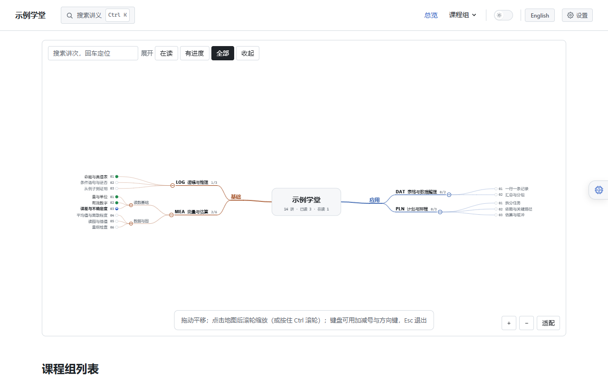
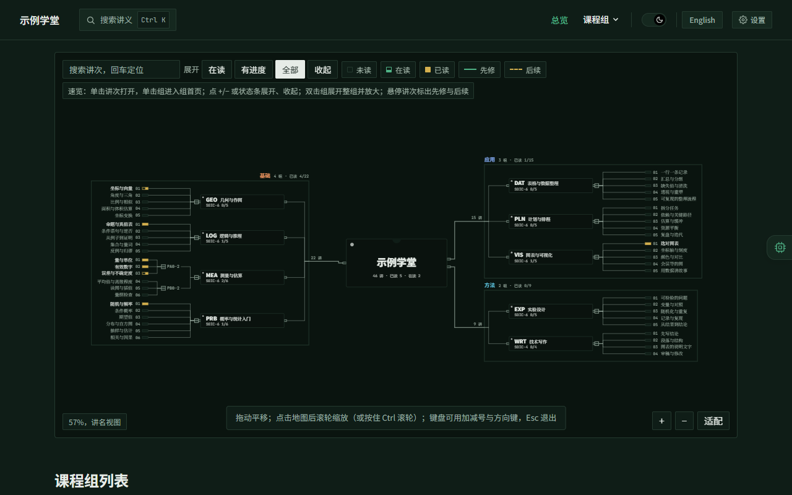
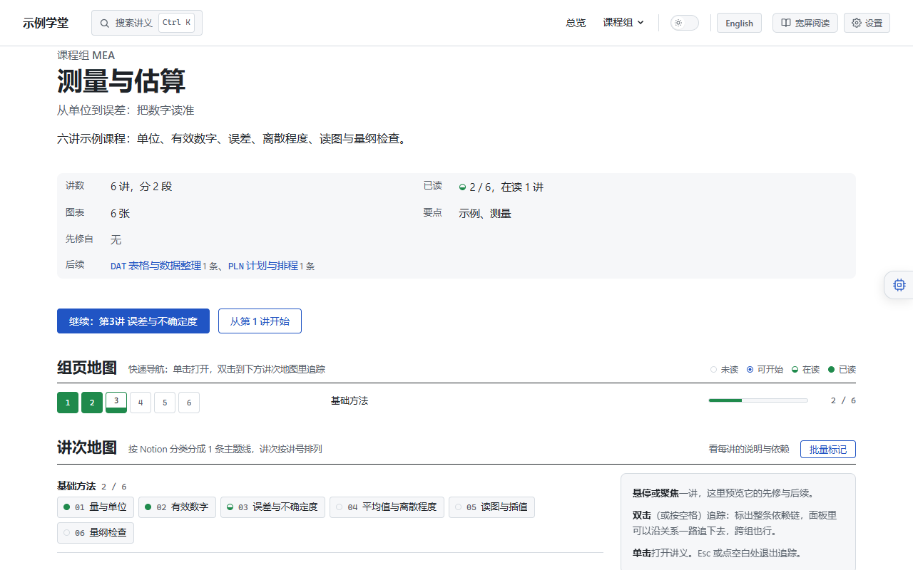
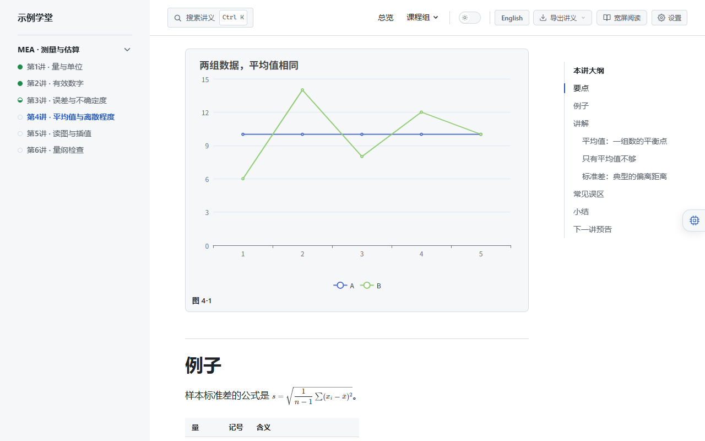
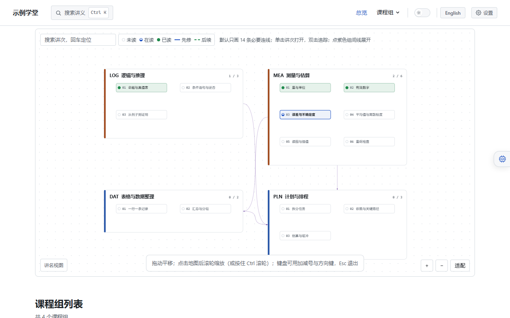
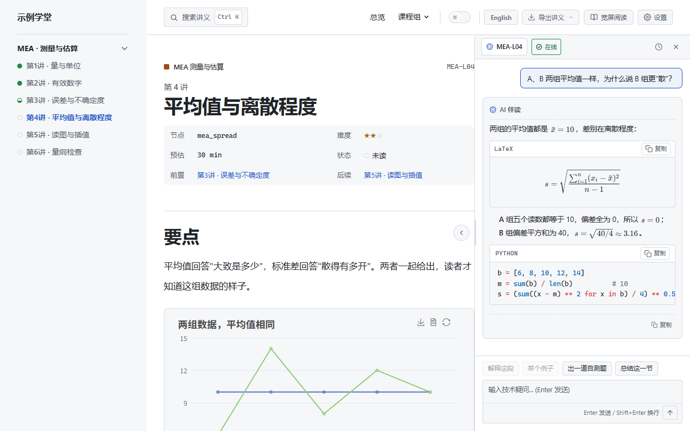

# Interactive Lecture Engine

**语言**：中文 · [English](./README.en.md)

一个把工程类讲义做成静态网站的引擎。讲义用 Markdown 写，可以放交互图表和公式；课程之间的先修关系画成可缩放的地图；读者的学习进度记在浏览器里。另有一个可选的后端 `lecture-api`，负责多设备进度同步、网关登录身份和 AI 伴读。

站点基于 VitePress 1.6 与 Vue 3，后端基于 Node.js 与 Hono，代码以 TypeScript 为主。

> 这是 V2，是一次重写：目录结构、配置文件和内容的放法都和 V1 不同，不能在 V1 的目录上直接升级。V1 的代码保留在 `main` 分支 V2 之前的历史提交里。

## 截图

截图来自引擎自带的示例内容（`npm run screenshots:readme` 生成）。

| | |
|---|---|
|  |  |
| 首页课程地图，reader 主题亮色 | 同一页，datasheet 主题暗色 |
|  |  |
| 课程组页：讲义列表、进度和组内地图 | 讲义页：图表与公式 |
|  |  |
| 全站先修依赖画布 | 概念页 |
|  |  |
| AI 伴读侧栏 | Dashboard 概览 |

<p align="center"><br>手机上的讲义页（390 px）</p>

## 功能

**讲义**

- Markdown 加 frontmatter。公式在构建时用 KaTeX 渲染，代码块用 Shiki 高亮。
- 图表：讲义里放占位，数据写在 `charts/<讲义>.json`，支持 ECharts、Mermaid 和 WaveDrom。
- 图包：按课程组管理的图片，带编号和交叉引用。`scripts/figures/import_figure.py` 可以从论文 PDF 截图入库。
- 概念页：独立的概念条目。讲义里的概念链接悬停时显示卡片，概念之间的关系另有关系图。

**导航与进度**

- 首页课程地图：按类别分区，可以缩放和平移。
- 全站先修依赖画布：用 ELK 自动布局。
- 课程组页：讲义列表、本组进度和组内地图。
- 侧栏课程菜单和全文搜索。
- 学习进度分未开始、学习中、已完成三种，存在浏览器里；接了后端就按用户同步。

**界面**

- 两套主题包：reader（默认，只用系统字体）和 datasheet，各有亮色和暗色。主题可以替换部分界面组件（插槽），也可以安装第三方主题包。
- 界面有中文和英文两种语言。讲义可以有英文译本，没有译本的讲义会标明。
- 讲义可以导出 PDF 和长图。这一项要另外安装无头 Chromium（`npm run pregen:setup`），默认不装。

**访问控制**

- 每个课程组可以设访问档：公开、登录用户、指定的用户组。
- 构建时受限内容（标题、正文、图表数据、搜索索引）不进公开文件，同时生成给 nginx 用的网关清单。读者身份由前置网关（例如 Authelia）通过请求头传给站点和后端。

**AI 伴读（可选）**

- 讲义页侧栏对话，带快捷动作：解释这段、举个例子、出一道自测题、总结这一节。快捷动作和提示词都可以在 Dashboard 里改。
- 线上经 `lecture-api` 转发到 OpenAI 兼容的模型接口，按用户限制每分钟次数和每日次数；也可以让读者在浏览器里填自己的密钥直接调用。
- 模型可以调用 5 个引擎工具查站内内容：概念搜索、概念详情、概念关系图、讲义搜索、讲义摘要。同一组工具也以 MCP 服务（`/api/mcp`，需要令牌）提供给外部智能体。
- 在本机开发服务器上，作者可以让模型起草新的概念页或补充已有概念页；写入前会检查重名和链接。

**Dashboard**

- `/dashboard` 页面：内容检查结果、站点文案、伴读提示词和快捷动作、课程组与访问档、主题、运行状态和终端日志。
- 只有本机开发服务器上可以编辑，要求本机访问并带开发令牌；线上部署是只读的。

**内容与引擎分开**

- 讲义放在单独的内容目录 `content/`（建议自成一个 git 仓库），引擎仓库忽略这个目录。
- `npm run init` 从模板建内容目录；`new:group`、`new:lecture` 生成骨架；`check:content` 按讲义契约检查。
- 给编码智能体（Claude Code、Kiro 等）的规则写在 [`AGENTS.md`](./AGENTS.md)。

## 快速开始

需要 Node.js 20 或更新版本和 npm。部分辅助脚本（讲义检查、图片入库）需要 Python 3。

```bash
git clone <本仓库的地址>
cd Interactive-Lecture-Engine/site
npm ci
npm run dev        # 没有 content/ 时显示引擎自带的示例内容
```

建自己的内容：

```bash
npm run init                                                    # 在仓库根目录建 content/
npm run new:group -- --id G01 --dir g01 --title "第一门课"
npm run new:lecture -- --group G01 --title "第一讲"
npm run check:content
npm run build                                                   # 输出到 site/docs/.vitepress/dist
```

`npm run init` 建出的站点文案 `content/site-texts.json` 是空的，构建前至少要填中英文的站点名称（`name`），也可以在 Dashboard 的“站点文案”页里填。

写内容的规矩见 [docs/authoring/](docs/authoring/README.md)。

## 后端 lecture-api（可选）

只发布静态站点可以不要后端。需要多设备进度、登录身份或线上 AI 伴读时再部署它：

- Node.js 20+，Hono；
- 数据库用 PostgreSQL，或者内置的 PGlite（单机、零依赖）；
- 放在 nginx 和登录网关后面，由网关传入用户身份。

说明见 [server/README.md](server/README.md)，部署、网关、备份和升级见 [docs-dev/](docs-dev/)。

## 目录

```text
site/        VitePress 站点：主题、组件、构建插件、检查脚本、测试
server/      lecture-api 后端（可选）
templates/   新内容目录的模板
docs/        authoring/ 写内容的规矩、讲义契约和做法；backend-handoff/ 前后端接口契约；screenshots/ 本页截图
docs-dev/    维护者文档
scripts/     讲义检查、部署辅助、图谱导入、隐私扫描
```

## 文档

| 文档 | 内容 |
|---|---|
| [docs/authoring/](docs/authoring/README.md) | 写内容：讲义契约、新建课程组和讲义、图包、图谱、站点文案、访问档 |
| [docs-dev/CONFIG.md](docs-dev/CONFIG.md) | 配置文件、取值优先级、`npm run setup` 和 `npm run doctor` |
| [docs-dev/BUILD.md](docs-dev/BUILD.md) | 构建流程和内存占用 |
| [docs-dev/ACCESS.md](docs-dev/ACCESS.md) | 访问档的构建与网关清单 |
| [docs-dev/MAP.md](docs-dev/MAP.md)、[GROUP.md](docs-dev/GROUP.md) | 课程地图、依赖画布、课程组页 |
| [docs-dev/SLOTS.md](docs-dev/SLOTS.md) | 主题包和组件插槽 |
| [docs-dev/I18N.md](docs-dev/I18N.md) | 多语言 |
| [docs-dev/PROGRESS.md](docs-dev/PROGRESS.md) | 学习进度 |
| [docs-dev/CONCEPTS.md](docs-dev/CONCEPTS.md) | 概念页起草和伴读工具调用 |
| [docs-dev/FIGURES.md](docs-dev/FIGURES.md) | 图包 |
| [docs-dev/DEBUGGING.md](docs-dev/DEBUGGING.md) | 前端调试：API 模式和浏览器调试台 |
| [docs-dev/DEPLOY.md](docs-dev/DEPLOY.md)、[GATEWAY.md](docs-dev/GATEWAY.md)、[BACKUP.md](docs-dev/BACKUP.md)、[UPGRADE.md](docs-dev/UPGRADE.md) | 部署、网关、备份、升级与回退 |

## 开发与测试

```bash
cd site
npm run check        # 类型检查、lint、主题契约、单元测试、内容检查
npm run test:e2e     # Playwright 浏览器测试，跑在引擎自带的示例内容上
cd ../server
npm test             # 后端测试
```

提交前的隐私检查：`node scripts/privacy/install-hook.mjs` 装一个 pre-commit 钩子，拦住本机路径、邮箱、密钥形状的字符串和内容目录里的文件。CI 里也跑同一个扫描。

参与贡献见 [CONTRIBUTING.md](./CONTRIBUTING.md)，报告安全问题见 [SECURITY.md](./SECURITY.md)。

## 已知限制

- 界面文字目前只有中文和英文。
- Dashboard 只能在本机开发服务器上编辑。读者用量、备份列表等几项后端还没有接口，页面上标为暂不可用。
- 导出 PDF 和长图要下载无头 Chromium，默认不装。
- 大站点构建占内存多：约 450 页时峰值约 6 GB，小内存主机的做法见 [BUILD.md](docs-dev/BUILD.md)。
- AI 伴读需要一个 OpenAI 兼容的模型接口，费用由部署者承担。

## 许可

[MIT](./LICENSE)
