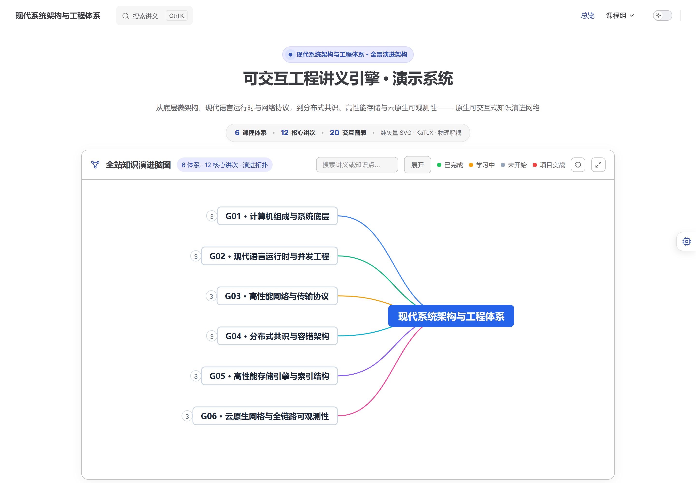
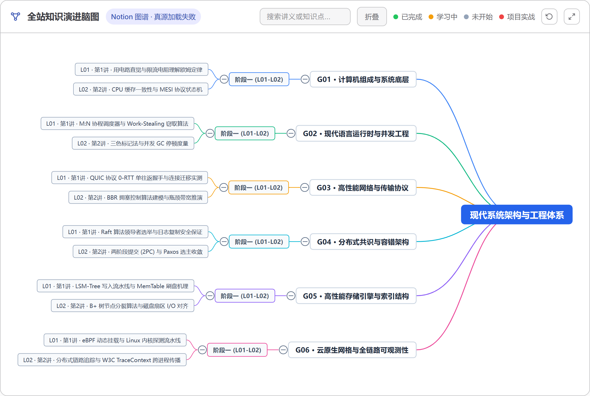
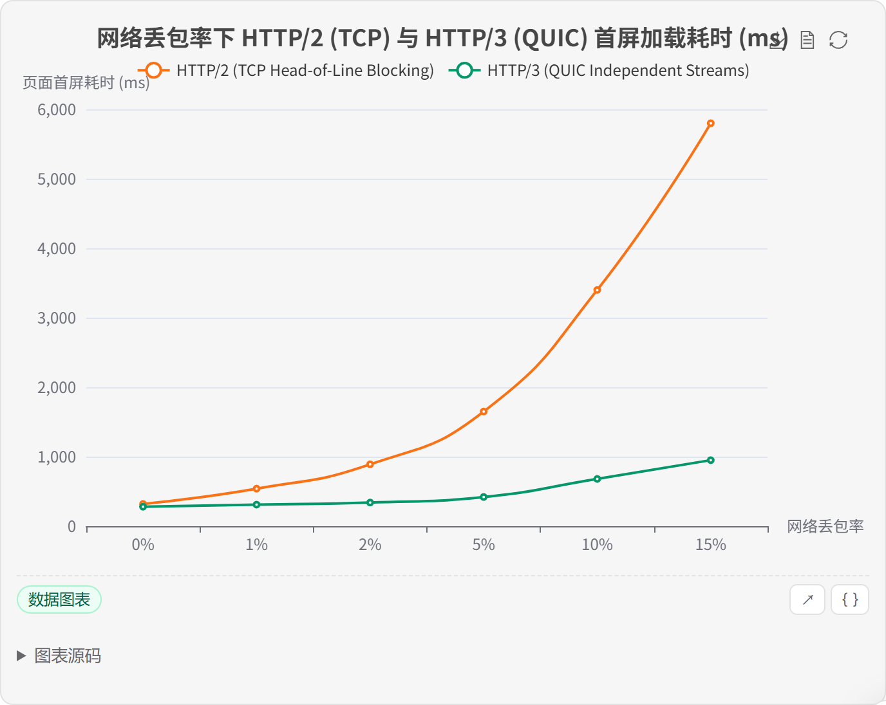
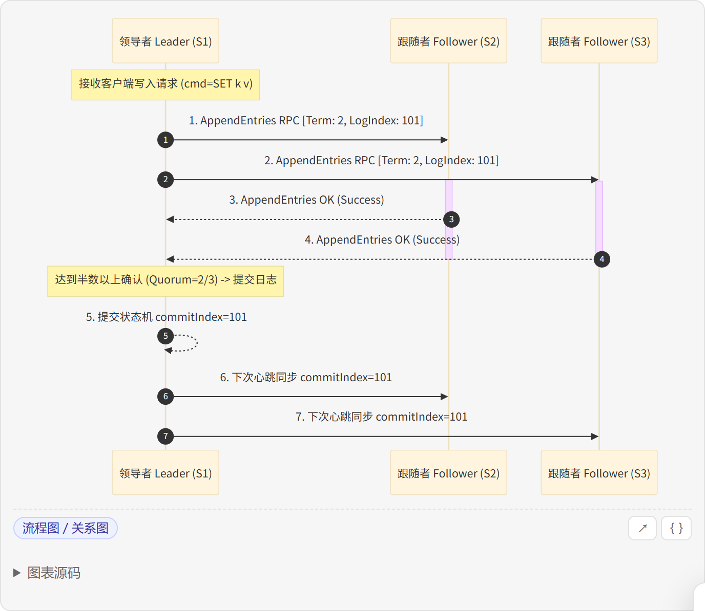
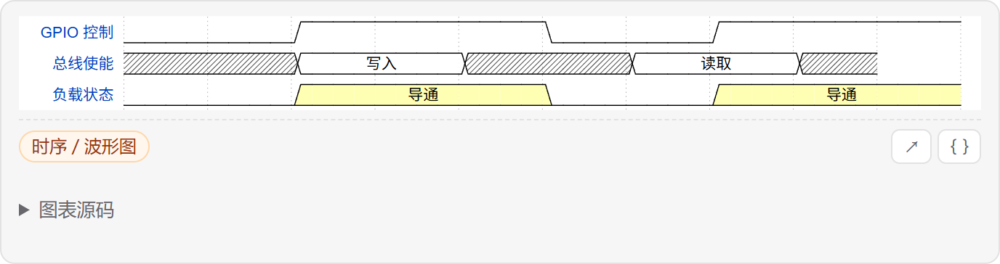
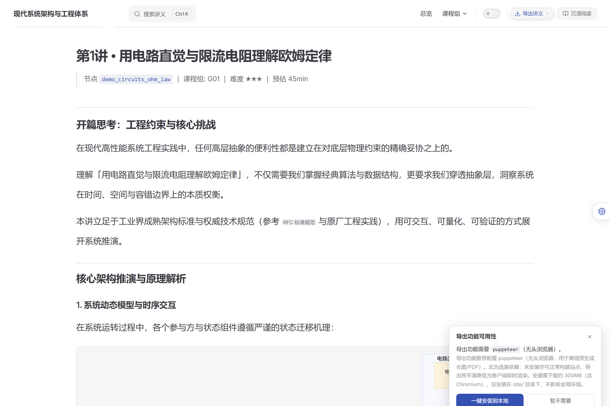
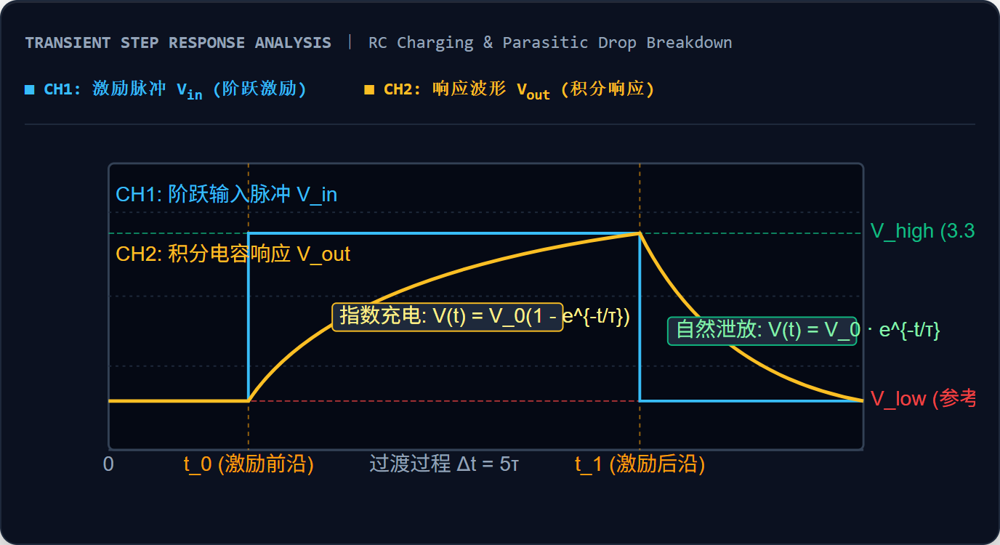
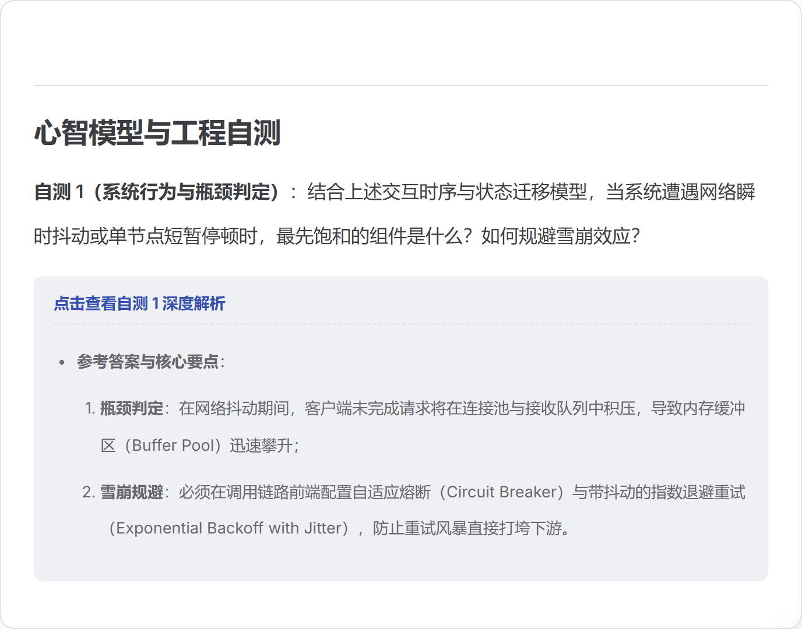
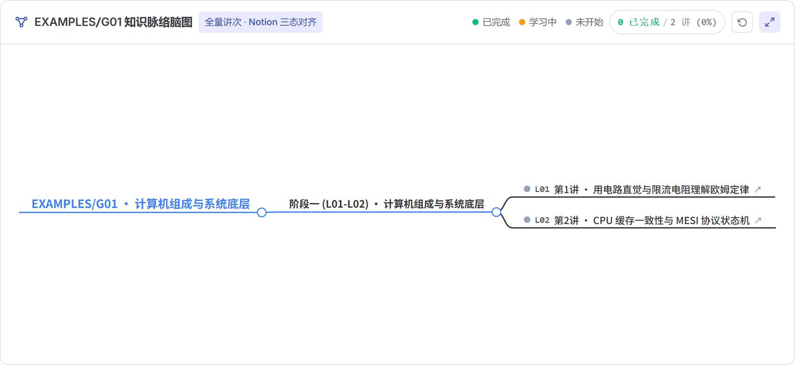
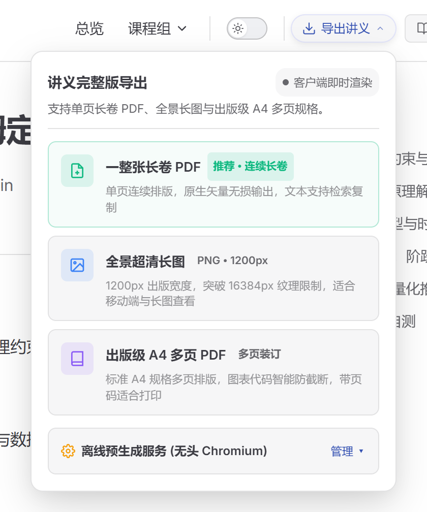

# 可交互工程讲义渲染引擎（Interactive Lecture Engine）

> **语言 / Language**: 中文 ｜ [English](./README.en.md)

> 一套将**现代工程与技术讲义**打造为**高品质交互式阅读与印刷级出版站点**的工业级开源渲染引擎：原生工程图表深度交互、构建期 KaTeX 严谨排版、SimpleMindMap 闭合几何投影全景脑图、时序与示波器仿真交互、随堂自测折叠抽屉、印刷级出版与导出套件（A4 智能跨页防截断 / Canvas 超清长图）、沉浸式工程阅读、无外链 `.cite` 引用胶囊体系、可插拔 AI 伴读侧栏 —— 全部组件化、零硬编码单一真源、内容与引擎即插即用物理级解耦。

<p>
  
  
  
  
  
  
  
  
</p>

<details>
<summary><b>English summary</b> (click to expand)</summary>

**A production-ready VitePress-based engine for rendering interactive technical courseware.**
Features native interactive diagrams (ECharts, Mermaid, WaveDrom) with a 100% pure SVG vector contract (zero emojis), SimpleMindMap closed geometric projection mind maps, publication-grade A4 PDF and ultra-HD canvas slice exports, build-time KaTeX with click-to-copy LaTeX source, oscilloscope simulation (`.scope-viewer`), quiz fold drawers, immersive reading mode, reading-progress memory, `.cite` citation chips, and a pluggable AI sidecar.

> For full English documentation, please refer to [`README.en.md`](./README.en.md).
> The engine is language-agnostic: while the bundled minimal example is in Chinese, it renders content in any natural language.

</details>

---

## 📖 项目简介与核心架构 (Overview & Architecture)

**Interactive Lecture Engine** 是一套面向现代硬核工程课程与技术文档的**可交互讲义静态渲染引擎**。它基于 VitePress 深度定制，专为高密度技术内容（嵌入式系统、计算机体系、系统编程、网络通信、分布式架构等）提供工业级的富媒体交互与严谨工程排版能力。

本引擎采用**内容与引擎物理分离的插拔式架构**（Content-Engine Decoupling）：引擎核心专注于渲染机制、仿真运行时、知识演进图谱与静态编译；讲义内容以标准 Markdown 与 Sidecar JSON 独立维护。

仓库内置了一套涵盖 6 大工程领域的**完整演示课程体系**（位于 `site/docs/examples/`），开箱即用，全面展现交互图表、KaTeX 矢量公式、示波器对比、自测解析抽屉、沉浸式阅读与出版级 PDF 导出等全部特性。

```text
Interactive-Lecture-Engine/
├── site/                          # 渲染引擎核心本体 (VitePress 驱动)
│   ├── docs/
│   │   ├── .vitepress/
│   │   │   ├── config.mts         # 站点配置中枢 (导航/侧边栏/搜索自适应派生)
│   │   │   ├── site.config.mts    # 前端零硬编码单一真源 (接口/存储键/字体栈/工具栏)
│   │   │   ├── math.mts           # 构建期 KaTeX 严谨数学排版插件
│   │   │   └── theme/             # 主题组件库：图表运行时 / 阅读模式 / 导出套件 / AI 伴读
│   │   ├── examples/              # 开箱即用最小示例内容源 (规范级基准模板)
│   │   └── public/                # 静态资产与展示物料
│   └── package.json               # 前端核心依赖定义
├── scripts/                       # 工业级管线工具集 (质量闸门 / 串行安全构建 / 内容插拔 / 审计)
├── content-sources/               # 外部讲义内容包挂载源 (已被 .gitignore 严格忽略，杜绝泄露)
├── docs-shared/                   # 讲义正文排版与图表 sidecar 共享契约规范
├── content/                       # 讲义撰写、公式规范与内容接入指南
├── engine/                        # 渲染引擎底层架构设计与技术实现说明
└── ops/                           # 运维、构建防并发机制与合规审计报告
```

---

## 🌟 效果预览 (Visual Tour & Showcase)

> 以下所有效果截图均采集自本引擎真实运行环境（2x 超清 Retina 截屏），完整呈现从知识图谱、原生图表交互、工科仿真到出版级导出的全链路体验。

### 1. 站点总览与知识脉络全景

| 首页总览与知识特性矩阵 | SimpleMindMap 闭合几何投影全景脑图 |
|---|---|
|  |  |
| **Hero 引导中枢**：动态指标卡片、学习续读提示与知识演进入口 | **闭合几何投影算法**：自适应计算边界盒与无重叠布局，零导航遮挡，支持层级缩放与全屏聚焦 |

### 2. 原生工程图表矩阵（纯 SVG 矢量契约 · 0 Emoji 混用）

全站图表工具条全面升级为**纯 SVG 矢量图形契约**，彻底告别跨平台 Emoji 渲染色差与形变，内联视图遵循「只看不可误触」原则，一键全屏展开支持平移缩放、网格吸附与源码折叠。

| ECharts · 动态交互数据曲线 | Mermaid · 工业级架构与流程图 | WaveDrom · 数字硬件时序与寄存器 |
|---|---|---|
|  |  |  |
| 双轴对齐、呼吸内边距、悬停十字准线与图例筛选 | 纯 SVG 矢量工具栏、源码抽屉折叠展开、无损缩放 | 硬件时钟上升沿对齐、总线跳变推演与寄存器位域 |

### 3. 工科深度交互与沉浸式阅读体验

| 沉浸式阅读模式（75vw 黄金版心） | 典雅引用胶囊 `.cite` 体系 |
|---|---|
|  |  |
| 一键隐匿双侧边栏，版心自适应放宽，行距调节，自动记忆上次阅读位置 | **全站禁用原生外链**，统一浅色胶囊化悬停交互，在新标签页无缝展开 |

| 虚拟双通道示波器观测台（`.scope-viewer`） | 交互式随堂测验抽屉（`::: details`） |
|---|---|
|  |  |
| 嵌入式直通冲击 vs 限流平抑波形对比，支持时基分度与峰峰值计算 | 随堂问题交互式抽屉，点击折叠/展开解题推导与深层原理反思 |

### 4. 课程拓扑演进与出版级导出套件

| 课程组专属进阶知识拓扑 | 印刷级出版套件 HUD（A4 PDF / 超清长图） |
|---|---|
|  |  |
| 讲次、知识阶段与前后置依赖全自动拓扑生成 | 一键导出 A4 智能防截断 PDF、连续平铺 PDF 与超清长图 PNG |

---

## 一、快速开始 (Quick Start)

### 1. 环境准备
- **Node.js**: `≥ 18.0.0` (推荐 Node.js 20 LTS)
- **Python**: `≥ 3.10` (用于执行全套质量闸门与内容管线，仅需标准库，无需额外 pip 安装)

### 2. 克隆与依赖安装
```bash
git clone https://github.com/YangObscurity/Interactive-Lecture-Engine.git
cd Interactive-Lecture-Engine/site
npm ci
```

### 3. 本地极速开发预览（带毫秒级 HMR 热重载）
```bash
npm run dev
# 开发服务器将在 http://localhost:5173 启动
```
在浏览器中打开后，即可直接交互体验 `examples/g01/L01.html` 等演示讲义。

### 4. 生产构建与安全串行锁
```bash
# 推荐使用安全串行构建入口（自动申请跨进程互斥锁，避免并发构建破坏产物）
python ../scripts/safe_build.py --purpose "生产发布验证"
```
构建成功后，静态文件输出至 `site/docs/.vitepress/dist`。

---

## 二、核心特性与技术亮点

### 1. 纯 SVG 矢量图标契约 (Zero-Emoji Contract)
- **拒绝字符集差异**：传统 Web 文档常使用 Emoji 符号作为操作按钮，在不同操作系统与高分屏下容易出现模糊、失真甚至字体回退（Tofu 字符）；
- **全矢量图形收口**：图表工具栏（全屏、源码折叠、重置缩放、复制）全部升级为高精度纯内联 SVG，并在 `site.config.mts` 中集中定义，保证在所有视网膜屏幕与黑暗模式下呈现极致锐利的渲染品质。

### 2. SimpleMindMap 闭合几何投影全景脑图
- **自适应边界盒算法**：摒弃传统第三方脑图组件布局错乱、边缘遮挡的缺陷，引入全景闭合几何投影引擎；
- **零导航重叠**：自动计算全站课程组、讲次编号、知识阶段与逻辑依赖关系，进行精准的重投影与动态居中，支持节点折叠展开与沉浸式全屏研读。

### 3. 印刷级出版与导出套件 (Publishing-Grade Export Suite)
- **A4 页面智能跨页防截断**：通过注入无头 Chrome 打印专用的分页 CSS 规则（`break-inside: avoid`），强制正文段落、代码围栏、公式块与交互图表在分页处完整显示，杜绝半张图表或单行代码被物理折断；
- **Canvas 超清矢量切片长图**：集成 `html-to-image` 引擎，以 2x 设备像素比对 DOM 树进行超清矢量渲染采样，一键导出完整讲义长图；
- **智能 HUD 交互浮层**：在讲义右上角常驻微交互导出按钮，智能感知宿主系统的 Chrome/Puppeteer 环境，提供丝滑下载进度反馈。

### 4. 构建期 KaTeX 严谨排版体系
- **语法边界守卫**：公式解析器严格匹配 `\(…\)`（行内）与 `$$…$$` / `\[…\]`（行间），**坚决不接管裸 `$…$` 字符**（彻底避免中文技术散文中的货币符号 `$1000`、NMEA 协议 `$GNRMC`、ARP 变量 `ar$` 触发意外数学解析）；
- **点击复制 LaTeX 源码**：公式节点构建期渲染为带 `data-tex` 属性的 `<span class="math-node">`，读者轻点即可一键复制原始公式源码；
- **严苛高度与行距契约**：严格规范物理量关系采用 `\dfrac`，多项式系数采用 `\frac`，指数与单位保留 SI 惯例斜杠，行内公式实测高度完全吻合正文行距，杜绝撑大段落。

### 5. 原生可交互工程图表与 Sidecar 契约
正文中仅需书写极其简洁的空占位符：
```html
<figure class="chart" data-lecture="EX-L01" data-id="c1" data-type="echarts"></figure>
```
配合独立的 sidecar JSON 声明：
```json
{
  "c1": {
    "type": "echarts",
    "title": "LED 正向伏安特性与限流工作点",
    "code": "{ \"xAxis\": { \"name\": \"正向电压 (V)\" }, \"yAxis\": { \"name\": \"正向电流 (mA)\" }, \"series\": [...] }"
  }
}
```
- **支持引擎**：`echarts`（数据曲线与动态图表）、`mermaid`（架构拓扑与流程图）、`wavedrom`（硬件时钟与数字总线时序）；
- **对账不变量**：Markdown 正文中的 `data-id` 与 JSON 文件中的 Key 必须保持**严格 1:1 双向对应**，多一个少一个均会被自动化闸门直接拦截（`check_figs2.py` 严格校验）。

### 6. 虚拟示波器与随堂自测抽屉
- **`.scope-viewer` 观测台**：真实复刻示波器荧光刻度屏、触发状态标签、CH1/CH2 信号峰峰值与频率动态读数，为嵌入式与软硬件开发讲义提供身临其境的实验观测体验；
- **随堂测验抽屉**：采用 VitePress 原生 `::: details` 语义块定制，将题目与答案深度推导解耦，引导读者主动思考、即时自我检验。

### 7. 沉浸式阅读与无外链引用胶囊体系
- **沉浸式阅读**：一键折叠导航栏与侧边大纲，版心自适应放宽至 75vw 黄金阅读视野，正文行高自动上调，状态自动持久化于 LocalStorage，支持跨页面无缝记忆；
- **全站禁用原生外链**：传统 Markdown 超链接语法（带蓝色高亮与下划线）会严重打断中文技术文档的阅读心流。本引擎推行统一的浅色 `.cite` 胶囊：
  ```html
  <span class="cite" data-cite="https://..." title="https://...">参考规范名称</span>
  ```
  悬停优雅浮现目标网址，点击直接在新标签页中安全打开。

### 8. 零硬编码单一真源 (`site.config.mts`)
全站所有关键元数据、接口路径、LocalStorage 存储键名、字体栈声明与图表工具按钮文案全部集中收口在 `site/docs/.vitepress/site.config.mts`。杜绝在任何业务组件或页面散落魔法字符串。

---

## 三、内容源分离架构（引擎与讲义解耦）

为了实现**开源代码无私有内容残留、自用开发零拷贝无损刷新**，本引擎确立了工业级的内容与引擎物理隔离方案：

```text
content-sources/<你的课程名>/
├── groups.mts                      # 课程组元信息（名称、编号、强调色、描述）
└── docs/
    ├── <group>/L01.md              # 讲义正文（严格遵循 ^L\d+\.md$ 规范）
    ├── <group>/index.md            # 课程组落地页
    └── public/charts/<GROUP>-L01.json # Sidecar 图表独立数据文件
```

通过内置中枢脚本 `scripts/mount_content.py`，实现即插即用的内容挂载管线：

```bash
# 1. 查看当前已发现的所有可用内容源
python scripts/mount_content.py --list

# 2. 挂载指定内容源（基于软链接/硬拷贝，默认 dry-run，须追加 --apply 写入）
python scripts/mount_content.py --mount my-course --apply

# 3. 校验讲义图表锚点与 JSON sidecar 的 1:1 双向契约
python scripts/mount_content.py --verify

# 4. 精准卸载内容源（恢复引擎纯净初始状态，绝不误删引擎原生文件）
python scripts/mount_content.py --unmount --apply

# 5. 强制深度清理（清除非白名单内容，确保 100% 达到开源交付纯度）
python scripts/mount_content.py --clean
```

- **安全防御**：核心保护目录（`.vitepress/`、`examples/`、站点 Logo 等）受白名单严格防护，外部内容源绝无法越权覆盖；
- **自用开发**：基于软链接直连私有讲义，本地编辑保存后 VitePress 毫秒级热刷新（HMR），体验与单体仓库完全一致；
- **开源发布**：执行 `--unmount` 或 `--clean` 后，瞬间还原为零私有内容、零敏感信息的开源骨架。

### 智能热插拔与示例自动隔离 (Dynamic Example Fallback & Exclusive Isolation)

为了让开源开箱即用体验与个人讲义私密性达到极致平衡，引擎内置了**双态自动切换与物理隔离机制**：

1. **未载入个人讲义时（纯引擎态）**：
   - 引擎自动加载 `site/docs/examples/` 下的示例课程与交互图表；
   - 导航、大纲脑图、侧边栏全功能激活，作为开箱即用的结构样板与能力走查展示。
2. **已载入个人讲义时（个人独占态）**：
   - 一旦通过 `mount_content.py` 挂载外部讲义、在本地创建 `site/docs/.vitepress/groups.mts`、或放入课程目录，引擎**自动感知并彻底屏蔽示例体系**（`examples/` 目录绝对不加载）；
   - VitePress 构建配置自动注入 `srcExclude: ['examples/**']`，使得所有示例 Markdown **彻底不参与页面编译、不生成 HTML 静态页、不注入任何本地搜索索引（Local Search）**；
   - 顶栏下拉导航、左侧讲次目录、全站知识脑图与首页指标 **100% 独占呈现用户个人课程体系**，零残留、零交叉污染。
3. **无缝回滚复原**：
   - 执行 `python scripts/mount_content.py --unmount` 卸载讲义后，引擎瞬时切回通用示例模式，重新呈现演示内容。

---

## 四、配置管理与零凭据入库

项目严格遵循十二要素应用规范与开源隐私铁律，**仓库内部绝对不包含任何真实密钥、令牌或私有环境凭据**：

```bash
# 从示例模板复制生成本地环境配置（.env 已被 .gitignore 全局排除）
cp .env.example .env
```

| 环境变量配置项 | 功能说明与用途 | 默认脱敏值 |
| :--- | :--- | :--- |
| `NOTION_TOKEN` | Notion 内容集成只读令牌（可选，仅用于内容同步工具） | 空（须本地配置） |
| `DEPLOY_HOST` | 生产发布目标主机 IP 或解析域名 | `127.0.0.1` |
| `DEPLOY_PORT` | SSH / SCP 远程部署端口号 | `22` |
| `DEPLOY_USER` | 部署机认证用户名 | `deploy` |
| `DEPLOY_SSH_KEY` | 部署专用 SSH 私钥绝对路径（跨平台支持） | `~/.ssh/id_ed25519` |
| `DEPLOY_WEBROOT` | 远端 Web 服务器 Nginx 部署根目录 | `/var/www/lecture` |
| `DEPLOY_SITE_DOMAIN` | 线上正式域名（用于自动化发布后走查与探活） | `example.com` |

配置取用优先级：**CLI 命令行参数 > 环境变量 > `.env` 配置文件 > 代码内置安全回退值**。
在日志打印与调试调用中，`describe()` 会自动对敏感字符串进行掩码脱敏，杜绝日志二次泄露。

---

## 五、12 道工业级质量闸门全量矩阵

本项目将「确保软件质量、杜绝重构退化」转化为**确定性的自动化断言体系**。每次合并或发布前，只需运行统一闸门脚本：

```bash
# 一键运行全量质量闸门（自动化严格校验）
python scripts/audit_all.py

# 生产级终验验证（全站构建 + 全量闸门连环审计）
python scripts/audit_all.py --build
```

| 编号 | 闸门代号 (Gate) | 核心脚本 / 判据 | 核心断言内容与交付指标 | 判定期望 |
| :---: | :--- | :--- | :--- | :---: |
| **01** | `build` | `scripts/safe_build.py` | 全站生产环境 SSR 静态构建，跨进程互斥防并发打断 | `✓ rendering pages` |
| **02** | `pages` | `scripts/audit_all.py` | 全站 `.html` 产物数量守恒（基线自适应，防止静默丢页） | `页面数 ≥ 基线` |
| **03** | `links` | `scripts/check_body_links.py` | 扫描构建后 HTML 正文，断言杜绝任何原生蓝色外链 | `<a> = 0` 且 `.cite > 0` |
| **04** | `angle` | `scripts/test_angle.py` | 散文与行内代码尖括号（`<`）Vue 编译器安全转义机制 | **15/15 PASS** |
| **05** | `figs` | `scripts/check_figs2.py` | 正文 `<figure>` 锚点与 Sidecar 图表 JSON 严格 1:1 双向对应 | **不一致数 = 0** |
| **06** | `format` | `scripts/format_audit.py` | 源码级 LaTeX 数学规范（M1~M5）与工科中文排版格式（F1~F4） | **高危违规 = 0** |
| **07** | `bare_urls` | `scripts/audit_bare_urls.py` | 讲义 Markdown 正文内裸 URL 与未加协议域名清理 | **裸 URL 残留 = 0** |
| **08** | `deps` | `scripts/check_deps.py` | 前端源码 `import` 引用与 `package.json` 依赖声明一致性对账 | **幽灵/僵尸依赖 = 0** |
| **09** | `encoding` | `scripts/check_encoding.py` | 全站文件 UTF-8 编码完整性检查（杜绝 U+FFFD 乱码、BOM 与 CRLF 混用） | **编码缺陷 = 0** |
| **10** | `secrets` | `scripts/scan_secrets.py` | 深度扫描高危密钥格式、真实服务器 IP、敏感邮箱与个人隐私 | **高危泄露 = 0** |
| **11** | `example` | `scripts/check_example.py` | 开箱即用内置示例内容源结构、元信息与图表渲染契约 | **示例契约成立** |
| **12** | `docs` | `scripts/doc_audit.py` | 仓内所有 Markdown 相对引用与死链静态扫描，结构健全性检查 | **断链/坏链 = 0** |

---

## 六、从哪里开始 (Where to start)

无论你的角色是什么，都可以通过下表快速定位核心文档：

| 你的目标 | 推荐阅读文档与指南 |
| :--- | :--- |
| **快速了解站点如何运行** | [`engine/README.md`](./engine/README.md) |
| **定制图表工具栏、缩放交互与样式** | [`engine/charts.md`](./engine/charts.md) |
| **新增一门课程或一篇技术讲义** | [`content/add-lecture.md`](./content/add-lecture.md) |
| **查阅讲义正文与图表 JSON 契约规范** | [`content/README.md`](./content/README.md) ｜ [`docs-shared/CHARTS_SPEC.md`](./docs-shared/CHARTS_SPEC.md) |
| **接入你自己的课程讲义库** | [`content/CONTENT_SOURCE.md`](./content/CONTENT_SOURCE.md) ｜ [`content-sources/README.md`](./content-sources/README.md) |
| **运维构建、生产部署与视觉走查** | [`ops/README.md`](./ops/README.md) |
| **参与开源项目贡献** | [`CONTRIBUTING.md`](./CONTRIBUTING.md) ｜ [English](./CONTRIBUTING.en.md) |
| **AI 编程助手协同工作规范** | [`AGENTS.md`](./AGENTS.md) ｜ [`GEMINI.md`](./GEMINI.md) |

---

## 七、核心设计哲学与工程原则

1. **职责分离（Componentised Separation）**：内容改动绝不碰主题渲染，主题改动绝不碰讲义正文；
2. **数字永不手写（Never Hand-write Numbers）**：全站讲次总数、图表总数、字数统计全部由引擎在构建期动态计算，杜绝文档与代码事实产生脱节；
3. **单一真源（Single Source of Truth）**：同一配置项或数据模型只允许在一处定义，代码内杜绝冗余重复；
4. **配置完全外置（Configuration Externalised）**：敏感参数一律支持环境变量注入，代码仓库内部绝不留存任何生产凭据；
5. **质量闸门优先（Gates First）**：所有声称「不退化、无破坏」的代码修改，都必须有确定性的自动化测试与退出码支撑。

---

## 八、开源协议与版权说明 (License)

本项目采用 [MIT License](./LICENSE) 协议开源。你可以自由使用、修改、分发或将其用于商业化技术课程站点。

> **开源范围与版权归属**：
> 本仓库开源内容为技术讲义渲染引擎核心与通用工具链本体。
> 使用者挂载或接入的自定义课程讲义版权归其创作者所有。用于挂载内容的目录已被 `.gitignore` 全局排除，确保用户自定义内容与开源引擎内核物理隔离。
