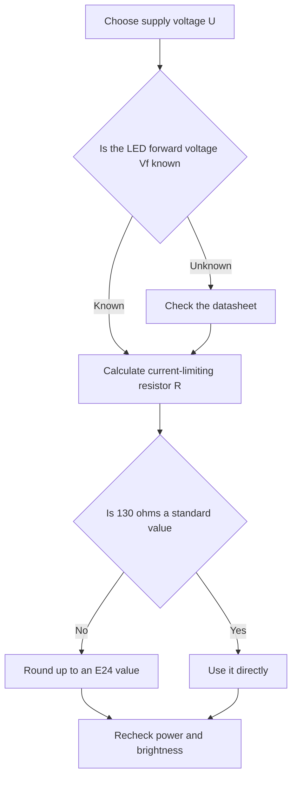
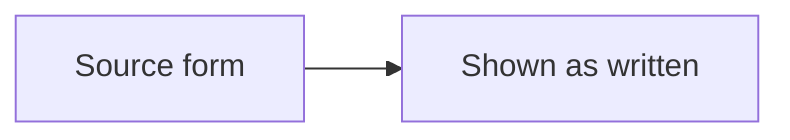

# Example Lecture 1 · Understanding Ohm's Law with an LED and a Current-Limiting Resistor

> Node `example_led_ohm_law` | Subgroup: EX | Difficulty ★ | Estimated 45 min | Prerequisites: none | Next: example_series_parallel

## Opening: The Easily Overlooked Resistor on a Dev Board

Almost everyone who starts with embedded systems does the same first thing: blink an LED. Connect the anode of the light-emitting diode (LED) to the 3.3 V pin of the development board, connect the cathode to ground, the light comes on, and the job is done.

Then many people add a second step almost by reflex: **put a resistor in series**. Ask why, and the answer is usually "every tutorial wires it that way" or "it burns out without one".

That answer is not wrong, but it turns something genuinely interesting into a rule of thumb. What is worth working out is this: **without the resistor, what exactly burns out? And how large should the resistor be?** The answers to these two questions happen to be the simplest and most useful application of Ohm's law.

This lecture does not try to cover many topics. It is a **demonstration of a pattern**: take the simplest possible case and walk through the full engineering order of "look at the physical constraint first, then calculate the numbers, and finally leave a margin".

## First, Be Clear: An LED Is Not a Resistor

To understand the current-limiting resistor, you first have to break one intuitive misconception. Many people picture an LED as "a resistor that glows", and so assume that current can rise and fall through it as freely as it does through a resistor. It cannot.

An LED is a **diode**, and its current-voltage characteristic is strongly nonlinear: before it turns on, the current is almost zero, and once the turn-on threshold is crossed, the current rises **exponentially**.

<figure class="chart" data-lecture="EX-L01" data-id="c1" data-type="mermaid"></figure>

This leads to a key conclusion: **an LED will not limit its own current to a safe value.** Connect it straight to a 3.3 V supply and it will "want" a current far beyond what it can tolerate. The bond wire and the PN junction inside the chip overheat within a very short time: first the brightness drops sharply and the junction temperature soars, then the device fails completely. This is the real mechanism behind "it burns out without a resistor".

So the job of the current-limiting resistor is not to "drop a bit of voltage". It is to **turn a roughly constant-voltage device into a system whose current is predictable and designable**.

## Ohm's Law: Tying Voltage, Current and Resistance Together

Ohm's law says that the current through a conductor is proportional to the voltage across it and inversely proportional to its resistance. Written inline, that is \( I = \dfrac{U}{R} \).

The most practical rearrangement of this formula is not solving for \(I\) but for \(R\), because what we actually want to control is the current:

$$ R = \dfrac{U_{\text{supply}} - U_{\text{LED}}}{I_{\text{target}}} $$

This formula is worth reading term by term:

- \(U_{\text{supply}}\) is the supply voltage you have available, for example 3.3 V;
- \(U_{\text{LED}}\) is the forward voltage the LED **maintains by itself** once it conducts (written \(V_f\)). It is an inherent property of the device and does not change with the resistor;
- the numerator \(U_{\text{supply}} - U_{\text{LED}}\) is the voltage that **actually falls across the resistor**;
- the denominator \(I_{\text{target}}\) is the brightness you want the LED to run at, which corresponds to a particular current.

For a typical low-power indicator LED, this forward voltage is around \(2.0\,\mathrm{V}\): lower for red (about 1.8–2.0 V), higher for blue and white (about 2.8–3.2 V). Always look this parameter up in the datasheet instead of going by memory.

## Working It Out: Lighting a Red LED from 3.3 V

<LectureFigure id="ohms-led-circuit" />

Now put in the numbers for the single-loop circuit shown in [](fig:ohms-led-circuit). Assume a \(3.3\,\mathrm{V}\) supply, a forward voltage \(V_f = 2.0\,\mathrm{V}\), and a target of \(10\,\mathrm{mA}\), a common level for indicator lights that is bright enough without wasting power.

Start with the numerator: the voltage across the resistor is \(3.3 - 2.0 = 1.3\,\mathrm{V}\). Then \( R = \dfrac{U}{I} \) gives:

$$ R = \dfrac{1.3\,\mathrm{V}}{0.01\,\mathrm{A}} = 130\,\Omega $$

130 Ω is not a common standard value. In the standard resistor series (E24), the closest value that is **not smaller** than it is 150 Ω. Here an important engineering discipline appears: **for a current-limiting resistor, round up to the next value, never down**. Too little current only makes the light dimmer, while too much current accumulates thermal damage.

With 150 Ω, the actual current is \( I = \dfrac{1.3}{150} \approx 8.7\,\mathrm{mA} \), which is still bright enough and safer.

While you are at it, check the resistor's power dissipation too. It decides whether you pick a 1/4 W or a 1/8 W part:

$$ P = \dfrac{U^2}{R} = \dfrac{1.3^2}{150} \approx 11.3\,\mathrm{mW} $$

11.3 mW is far below the rated power of any common package, so even the most ordinary 1/8 W resistor is more than enough. This also explains why the resistor in an LED circuit never gets hot.

## Let the Numbers Speak: How Current Changes with Resistance

Above we calculated only two points. In real debugging it is more useful to **see the whole trend**: as the resistance varies over a range, how do the current and the power each behave?

<figure class="chart" data-lecture="EX-L01" data-id="c2" data-type="echarts"></figure>

This chart shows something that is easy to overlook: **the relationship between current and resistance is a nonlinear inverse proportion**. In the low-resistance region (100–200 Ω), the current drops quickly with every small increase in resistance. In the high-resistance region, the curve is already very flat, and adding more resistance has almost no effect on brightness; it only wastes voltage headroom.

The engineering implication is that **the useful range for a current-limiting resistor is actually narrow**. Too small and the LED burns out, too large and it does not light; the sensible range is often just a few tens to a few hundred ohms. When selecting a value, aim for the "knee" of the curve rather than picking a large value by feel.

## A Real Debugging Scenario: Why the LED Does Not Light

After the theory is done, the most common fault at the bench is the opposite one: the LED **does not light**. Checking in the following order covers most cases:

<figure class="chart" data-lecture="EX-L01" data-id="c3" data-type="wavedrom"></figure>

This timing diagram shows the sequence of GPIO output levels. The key point of the check is to **first confirm that the pin really outputs a high level, and only then suspect the circuit**. If the multimeter reads only 0 V at the pin, the problem is in the software (the pin was not configured as an output, or it was multiplexed to another function), and the current-limiting resistor has nothing to do with it.

Only after confirming that the pin level is correct should you go on to check whether the polarity is reversed and whether the LED itself is damaged. This "software first, hardware second" order saves a great deal of time spent unsoldering and resoldering.

The drive-strength limit of a GPIO pin, and why a pin cannot drive a high-power load directly, involve fuller electrical-specification calculations. Here are authoritative sources for reference:

<span class="cite" data-cite="https://www.espressif.com/sites/default/files/documentation/esp32_datasheet_en.pdf" title="https://www.espressif.com/sites/default/files/documentation/esp32_datasheet_en.pdf">ESP32 datasheet (pin drive current and electrical characteristics)</span>

For general habits in choosing component parameters, this passive-component selection guide is a useful reference:

<span class="cite" data-cite="https://www.vishay.com/docs/28771/vmnppm.pdf" title="https://www.vishay.com/docs/28771/vmnppm.pdf">Vishay resistor selection and application notes</span>

## Waveform Comparison and Oscilloscope Measurements

In embedded hardware testing, besides measuring static DC quantities with a multimeter, the more essential technique is capturing the power-on transient waveform with an oscilloscope.

### Direct Surge vs. Current-Limited Damped Waveform

The waveform comparison grid below (`.wave-compare-grid`) shows the transient difference with and without the current-limiting resistor:

<div class="wave-compare-grid">
  <div class="wave-channel-card">
    <div class="wave-header">
      <span class="wave-channel-tag ch-yellow">CH1 · Direct power-on</span>
      <span class="wave-title">Overshoot and overcurrent surge</span>
    </div>
    <div class="wave-canvas-wrapper">
      <svg viewBox="0 0 320 120" preserveAspectRatio="none">
        <line x1="0" y1="90" x2="320" y2="90" stroke="rgba(255,255,255,0.15)" stroke-dasharray="3,3" />
        <path d="M 0 90 L 40 90 L 50 15 L 65 110 L 80 50 L 100 85 L 320 85" fill="none" stroke="#facc15" stroke-width="2.5" stroke-linejoin="round"/>
      </svg>
    </div>
    <div class="wave-metrics">
      <div class="metric-chip"><span class="metric-label">Peak current:</span> <span class="metric-val">185 mA</span></div>
      <div class="metric-chip"><span class="metric-label">Steady-state power:</span> <span class="metric-val">Overload damage</span></div>
      <div class="metric-chip"><span class="metric-label">Status:</span> <span class="metric-val" style="color: #ef4444;">Overstress: dangerous</span></div>
    </div>
  </div>

  <div class="wave-channel-card">
    <div class="wave-header">
      <span class="wave-channel-tag ch-cyan">CH2 · 150Ω in series</span>
      <span class="wave-title">Damped, controlled step</span>
    </div>
    <div class="wave-canvas-wrapper">
      <svg viewBox="0 0 320 120" preserveAspectRatio="none">
        <line x1="0" y1="90" x2="320" y2="90" stroke="rgba(255,255,255,0.15)" stroke-dasharray="3,3" />
        <path d="M 0 90 L 40 90 Q 55 42, 80 40 L 320 40" fill="none" stroke="#22d3ee" stroke-width="2.5" stroke-linecap="round"/>
      </svg>
    </div>
    <div class="wave-metrics">
      <div class="metric-chip"><span class="metric-label">Operating current:</span> <span class="metric-val">8.67 mA</span></div>
      <div class="metric-chip"><span class="metric-label">Resistor drop:</span> <span class="metric-val">1.30 V</span></div>
      <div class="metric-chip"><span class="metric-label">Status:</span> <span class="metric-val" style="color: #10b981;">Normal</span></div>
    </div>
  </div>
</div>

### Virtual Dual-Channel Oscilloscope Bench

In real debugging, a virtual oscilloscope (`.scope-viewer`) captures the LED anode-to-ground voltage (CH1, green trace, \(V_f \approx 2.0\,\mathrm{V}\)) and the voltage drop across the current-limiting resistor (CH2, blue trace, \(\Delta U \approx 1.3\,\mathrm{V}\)) at the same time:

<div class="scope-viewer">
  <div class="scope-top-bar">
    <div class="scope-brand">
      <svg width="14" height="14" viewBox="0 0 24 24" fill="none" stroke="currentColor" stroke-width="2">
        <circle cx="12" cy="12" r="10"/>
        <polyline points="12 6 12 12 16 14"/>
      </svg>
      <span>Virtual DSO 2000X</span>
    </div>
    <div class="scope-status-badges">
      <span class="scope-badge trig-ready">TRIG'D</span>
      <span class="scope-badge trig-auto">Edge: CH1 Rising 1.65V</span>
    </div>
  </div>

  <div class="scope-screen">
    <div class="scope-graticule"></div>
    <svg class="scope-trace-canvas" viewBox="0 0 600 280" preserveAspectRatio="none">
      <path class="scope-trace-ch1" fill="none" stroke="#22c55e" stroke-width="2.5" stroke-linecap="round" stroke-linejoin="round" d="M 0 230 L 80 230 L 82 100 L 220 100 L 222 230 L 360 230 L 362 100 L 500 100 L 502 230 L 600 230" />
      <path class="scope-trace-ch2" fill="none" stroke="#00e5ff" stroke-width="2.5" stroke-linecap="round" stroke-linejoin="round" d="M 0 250 L 80 250 L 82 165 L 220 165 L 222 250 L 360 250 L 362 165 L 500 165 L 502 250 L 600 250" />
    </svg>
    <div class="scope-osd-info">
      <div class="scope-osd-channel">
        <span class="ch1-osd">CH1: 1.00 V/div</span>
        <span class="ch2-osd">CH2: 500 mV/div</span>
      </div>
      <div class="scope-osd-time">
        <span>Time: 200.0 us/div</span>
      </div>
    </div>
  </div>

  <div class="scope-bottom-readout">
    <div class="scope-readout-item">CH1 peak-to-peak: <strong>2.02 V</strong></div>
    <div class="scope-readout-item">CH2 peak-to-peak: <strong>1.31 V</strong></div>
    <div class="scope-readout-item">Signal frequency: <strong>1.00 kHz</strong></div>
    <div class="scope-readout-item">Duty cycle: <strong>50.0%</strong></div>
  </div>
</div>

## Capturing the Calculation in Code

Working a case or two by hand builds intuition, but a real project often needs a whole list of parameters checked. Writing the formula as a small script avoids arithmetic mistakes and also takes care of the "round up to a standard value" step:

```python
# Compute the current-limiting resistor for an LED from Ohm's law, rounded up to an E24 standard value
E24 = [100, 110, 120, 130, 150, 160, 180, 200, 220, 240, 270, 300, 330, 360, 390, 430, 470]

def led_resistor(v_supply, v_forward, i_target):
    """Return (resistance, actual current in A, resistor power in W). i_target is in amperes."""
    v_drop = v_supply - v_forward
    if v_drop <= 0:
        raise ValueError("The supply voltage must be higher than the LED forward voltage, or it will not light")
    ideal = v_drop / i_target
    # Key discipline: round up, never down -- better dim than overcurrent
    picked = next((r for r in E24 if r >= ideal), E24[-1])
    current = v_drop / picked
    power = v_drop * current
    return picked, current, power

r, i, p = led_resistor(3.3, 2.0, 0.010)
print(f"Pick {r}Ω, actual {i * 1000:.1f}mA, power {p * 1000:.1f}mW")
```

The output is `Pick 150Ω, actual 8.7mA, power 11.3mW`, exactly matching the hand calculation above.

Two points in this code are worth remembering. First, the `if v_drop <= 0` check is not redundant: powering a red LED with a 2.0 V forward voltage from a 1.8 V supply is a common beginner mistake, and having the program fail early beats being puzzled at the bench. Second, the comparison inside `next(...)` uses `>=`. The direction of that single symbol is how the "better dim than overcurrent" discipline lands in code.

If you want to quickly check the formula itself, a minimal calculation in the terminal is enough:

```bash
python3 -c "print('R =', (3.3 - 2.0) / 0.010, 'ohm -> pick 150 ohm')"
```

## Engine Feature Demo: Writing Flowcharts Directly in the Text

The charts above all come from sidecar JSON. But when writing lectures day to day, it is more convenient to **write Mermaid directly in the body text**.

Just label the code fence language `mermaid:chart` (note the `:chart` suffix), and the engine **automatically upgrades it into an interactive chart card**. You can enlarge it to full screen, view the source, and it redraws automatically with the site's dark and light themes:



When it is written as a **plain** `mermaid` fence (without `:chart`), it remains a **source listing**, which is exactly the effect needed when this document wants to demonstrate Mermaid syntax:



### Syntax Self-Healing: Charts Render Even When the Syntax Is Not Strict

Mermaid is quite picky about syntax, and one small flaw can turn the whole chart into a red error box. The engine has a built-in layer of **syntax self-healing** that automatically fixes the three most common problems:

- edge labels containing **parentheses or equals signs** (such as `-->|condition (note)|`): double quotes are added automatically;
- sequence-diagram messages containing a **semicolon** `;`: a semicolon is a statement separator in Mermaid and would cut the message short, so it is replaced with a full-width comma automatically;
- `classDef default` in state diagrams: this syntax is not supported and is removed automatically.

The edge labels in the chart below contain parentheses (`target selected (no load)`), which Mermaid would normally mistake for a node-shape declaration and report as an error. The engine adds the double quotes automatically before rendering:

```mermaid:chart
flowchart LR
    A[Power-on self-test] -->|Pass (green light steady)| B[Enter standby]
    A -->|Fail (red light blinking)| C[Log fault code]
    B -->|Command received (with checksum)| D[Execute action]
    C -->|Retry (at most three times)| A
```

The messages in the sequence diagram below contain a semicolon, which would also fail outright. The engine repairs it before rendering:

```mermaid:chart
sequenceDiagram
    participant M as Master
    participant S as Sensor
    M->>S: Start sampling; set enable at the same time
    S-->>M: Return result
    Note over M,S: Semicolons in messages are normalised by the engine
```

## Review Questions and Lab Self-Check

::: details Self-check 1: If the supply voltage rises to 5.0 V, what should the current-limiting resistor become?
**Worked solution**:

By Ohm's law:

$$ R = \dfrac{5.0\,\mathrm{V} - 2.0\,\mathrm{V}}{0.010\,\mathrm{A}} = \dfrac{3.0\,\mathrm{V}}{0.010\,\mathrm{A}} = 300\,\Omega $$

The E24 standard series has a **300 Ω** nominal value (you may also safely round up to 330 Ω, in which case the actual operating current is \( \dfrac{3.0}{330} \approx 9.09\,\mathrm{mA} \)).
:::

::: details Self-check 2: Why can't several LEDs be connected in parallel and share one current-limiting resistor?
**In-depth analysis**:

In theory, LEDs of the same model have the same nominal forward voltage \(V_f\). Because of manufacturing tolerances in semiconductors, however, the actual \(V_f\) of different dies varies at the millivolt level (for example, 1.95 V for LED A and 2.05 V for LED B).

When the two are connected directly in parallel:
1. The LED with the slightly lower voltage drop (1.95 V) conducts first and hogs most of the branch current;
2. As its current rises, its junction temperature rises, and the negative temperature coefficient of the semiconductor lowers its voltage drop even further, causing a **thermal-runaway positive feedback** until it overheats and fails;
3. Once it fails open, the entire loop current is suddenly forced into the second LED, which fails in an avalanche of consecutive burnouts.

Hence the engineering rule: **in parallel branches, every LED must have its own dedicated current-limiting resistor!**
:::

## Lecture Summary

Compressed into a few sentences, this lecture says:

- An LED is a **nonlinear device**. It does not limit current by itself; an external resistor does;
- The practical form of Ohm's law is \( R = \dfrac{U_{\text{supply}} - U_{\text{LED}}}{I_{\text{target}}} \), where the numerator is the voltage that actually falls across the resistor;
- **Round up to a standard value** and check the power dissipation as well. This is the concrete way to "leave a margin";
- When the LED does not light, **first confirm the pin level, then suspect the circuit**.

These conclusions are not complicated in themselves. What matters is the order behind them: **recognise the physical constraint first, then calculate the numbers, and finally leave a margin**. For any new device you meet later, you can apply the same order.

## Next Lecture Preview

In this lecture we handled only a single loop of "one supply + one resistor + one LED", where all the voltage was cleanly shared between two components. In real circuits, though, components are often **connected in series and in parallel at once**: two resistors in parallel share a current, several LEDs share one current-limiting resistor, a voltage divider taps a reference voltage from the middle. At that point, "where the current flows and where it branches" is no longer something you can see at a glance.

The next lecture, "Example Lecture 2 · Series and Parallel Circuits and Voltage Dividers: Where the Current Branches" (node `example_series_parallel`), extends this lecture's single-loop conclusions to multi-branch networks. It first builds the intuitive model of "series divides voltage, parallel divides current", then uses equivalent resistance to reduce a complicated network step by step to a single resistor, and finally lands on a high-frequency practical scenario: taking a 3.3 V reference level from 5 V with a divider, and seeing why this wiring "sags" under load and how its selection discipline differs from that of a current-limiting resistor.
