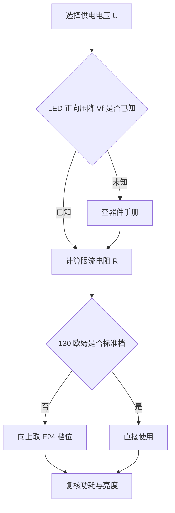

# 示例第1讲 · 用 LED 与限流电阻理解欧姆定律

> 节点 `example_led_ohm_law` ｜ 亚组: EX ｜ 难度 ★ ｜ 预估 45min ｜ 前置: 无 ｜ 后续: example_series_parallel

## 开篇：一块开发板上最容易被忽略的那颗电阻

几乎每个初学嵌入式的人，做的第一件事都是「点灯」。把发光二极管（LED）的正极接到开发板的 3.3 V 引脚，负极接到地，灯亮了，任务完成。

然后很多人会顺手加上第二件事：**中间串一颗电阻**。问为什么，答案通常是「教程都这么接」「不加会烧」。

这个回答不算错，但它把一件本来很有意思的事变成了口诀。真正值得弄清楚的是：**不加，到底会烧什么？加多少才合适？** 这两个问题的答案，恰好就是欧姆定律最朴素、也最有用的一次应用。

本讲不追求覆盖多少知识点，它是一次**范式演示**：用一件最简单的事，把「先看物理约束、再算数值、最后留余量」的工程顺序走完整。

## 先看清楚：LED 不是一个电阻

要理解限流电阻，必须先破掉一个直觉误区 —— 很多人把 LED 想象成「一个会发光的电阻」，于是觉得电流可以像流过电阻一样自由增减。实际并非如此。

LED 是**二极管**，它的伏安特性是强非线性的：在导通之前电流几乎为零，一旦越过导通门槛，电流就会**指数级**上升。

<figure class="chart" data-lecture="EX-L01" data-id="c1" data-type="mermaid"></figure>

这就带来一个关键结论：**LED 自己不会把电流限制在一个安全值上**。你把它直接接到 3.3 V 电源上，它就会「想要」一个远超自身承受能力的电流 —— 芯片内部的键合线与 PN 结会在很短的时间内过热，先是亮度骤降、结温飙升，随后彻底损坏。这就是「不加电阻会烧」的真正机理。

所以限流电阻的作用不是「分掉一点电压」，而是**把一个近似恒压的器件，变成一个电流可预测、可设计的系统**。

## 欧姆定律：把电压、电流、电阻锁在一起

欧姆定律说的是：流过一段导体的电流，与它两端的电压成正比，与它的电阻成反比。写成行内式就是 \( I = \dfrac{U}{R} \)。

这个式子最实用的变形不是求 \(I\)，而是求 \(R\) —— 因为我们真正想控制的是电流：

$$ R = \dfrac{U_{\text{电源}} - U_{\text{LED}}}{I_{\text{目标}}} $$

这个式子值得逐项读一遍：

- \(U_{\text{电源}}\) 是你能拿到的供电电压，比如 3.3 V；
- \(U_{\text{LED}}\) 是 LED 导通后**自己维持**的正向压降（记作 \(V_f\)），它是器件的固有属性，不随电阻变化；
- 分子 \(U_{\text{电源}} - U_{\text{LED}}\) 才是**真正落在电阻上的电压**；
- 分母 \(I_{\text{目标}}\) 是你希望 LED 工作在哪一个亮度、也就对应哪一个电流。

对常见的小功率指示 LED，这个正向压降大约是 \(2.0\,\mathrm{V}\) 上下：红光偏低（约 1.8–2.0 V），蓝光与白光偏高（约 2.8–3.2 V）。这个参数一定去查器件手册，不要凭印象。

## 算一遍：3.3 V 点一颗红光 LED

<LectureFigure id="ohms-led-circuit" />

把数字代进去（单回路连接如 [](fig:ohms-led-circuit) 所示）。假设供电 \(3.3\,\mathrm{V}\)，正向压降 \(V_f = 2.0\,\mathrm{V}\)，希望工作在 \(10\,\mathrm{mA}\) —— 这是指示灯的常见档位，亮度足够又不费电。

分子先算出来：落在电阻上的电压是 \(3.3 - 2.0 = 1.3\,\mathrm{V}\)。再由 \( R = \dfrac{U}{I} \) 得到：

$$ R = \dfrac{1.3\,\mathrm{V}}{0.01\,\mathrm{A}} = 130\,\Omega $$

130 Ω 不是一个常用标称值。电阻器的标准系列（E24）里，最接近且**不小于**它的档位是 150 Ω。这里出现了一条重要的工程纪律：**限流电阻宁可取大一档，不要取小一档**。因为电流偏小只会让灯暗一点，电流偏大则会累积热损伤。

换成 150 Ω 之后，实际电流是 \( I = \dfrac{1.3}{150} \approx 8.7\,\mathrm{mA} \)，仍然够亮，而且更安全。

顺手把电阻的功耗也核一下，这决定了你选 1/4 W 还是 1/8 W 的封装：

$$ P = \dfrac{U^2}{R} = \dfrac{1.3^2}{150} \approx 11.3\,\mathrm{mW} $$

11.3 mW 远低于任何常见封装的额定功耗，所以用最普通的 1/8 W 电阻都绰绰有余 —— 这也解释了为什么点灯电路里的电阻从来不会发烫。

## 让数字说话：电流随电阻怎么变

上面我们只算了两个点。实际调试时更有用的是**看清整条趋势**：当电阻在一个范围内变化时，电流和功耗会各自怎么走。

<figure class="chart" data-lecture="EX-L01" data-id="c2" data-type="echarts"></figure>

这张图说明了一件容易被忽视的事：**电流与电阻的关系是非线性的反比**。在低阻区（100–200 Ω），电阻每增加一点，电流就掉得很快；而在高阻区，曲线已经非常平缓，再加电阻对亮度几乎没影响，只是白白浪费压降。

工程上的含义是：**限流电阻的取值区间其实很窄**。太小会烧灯，太大则灯不亮，中间的合理区间往往只有几十到几百欧姆。选型时要落在曲线的「膝盖」附近，而不是凭感觉取一个很大的值。

## 一个真实调试场景：灯为什么不亮

理论算完，动手时最常见的故障却恰恰相反 —— 灯**不亮**。这时候按下面的顺序排查，能覆盖绝大多数情况：

<figure class="chart" data-lecture="EX-L01" data-id="c3" data-type="wavedrom"></figure>

这个时序图表示的是 GPIO 输出的电平状态序列。排查要点在于**先确认引脚真的输出了高电平，再去怀疑电路**：如果万用表量到引脚只有 0 V，那问题在软件（引脚没配置成输出、或者被复用成了别的功能），跟限流电阻一点关系都没有。

只有在确认引脚电平正常之后，才继续往下查极性是否接反、LED 是否本身损坏。这条「先软件后硬件」的顺序，能省下大量拔线重焊的时间。

关于 GPIO 引脚的驱动能力上限、以及为什么不能用引脚直接驱动大功率负载，涉及更完整的电气规格计算，这里先给出权威出处备查：

<span class="cite" data-cite="https://www.espressif.com/sites/default/files/documentation/esp32_datasheet_en.pdf" title="https://www.espressif.com/sites/default/files/documentation/esp32_datasheet_en.pdf">ESP32 数据手册（引脚驱动电流与电气特性）</span>

器件参数的通用取值习惯，可以参考这份被动元件选型说明：

<span class="cite" data-cite="https://www.vishay.com/docs/28771/vmnppm.pdf" title="https://www.vishay.com/docs/28771/vmnppm.pdf">Vishay 电阻选型与应用说明</span>

## 波形对比与示波器实测

在嵌入式硬件测试中，除了万用表测静态直流量，更核心的手段是用示波器抓取上电瞬态波形。

### 直通冲击 vs 限流平抑波形对比

下面的波形对比网格（`.wave-compare-grid`）直观展现了有无限流电阻时的瞬态差别：

<div class="wave-compare-grid">
  <div class="wave-channel-card">
    <div class="wave-header">
      <span class="wave-channel-tag ch-yellow">CH1 · 直通上电</span>
      <span class="wave-title">过冲过流冲击</span>
    </div>
    <div class="wave-canvas-wrapper">
      <svg viewBox="0 0 320 120" preserveAspectRatio="none">
        <line x1="0" y1="90" x2="320" y2="90" stroke="rgba(255,255,255,0.15)" stroke-dasharray="3,3" />
        <path d="M 0 90 L 40 90 L 50 15 L 65 110 L 80 50 L 100 85 L 320 85" fill="none" stroke="#facc15" stroke-width="2.5" stroke-linejoin="round"/>
      </svg>
    </div>
    <div class="wave-metrics">
      <div class="metric-chip"><span class="metric-label">峰值电流:</span> <span class="metric-val">185 mA</span></div>
      <div class="metric-chip"><span class="metric-label">稳态功耗:</span> <span class="metric-val">过载损坏</span></div>
      <div class="metric-chip"><span class="metric-label">状态:</span> <span class="metric-val" style="color: #ef4444;">Overstress 危险</span></div>
    </div>
  </div>

  <div class="wave-channel-card">
    <div class="wave-header">
      <span class="wave-channel-tag ch-cyan">CH2 · 串联 150Ω</span>
      <span class="wave-title">阻尼受控阶跃</span>
    </div>
    <div class="wave-canvas-wrapper">
      <svg viewBox="0 0 320 120" preserveAspectRatio="none">
        <line x1="0" y1="90" x2="320" y2="90" stroke="rgba(255,255,255,0.15)" stroke-dasharray="3,3" />
        <path d="M 0 90 L 40 90 Q 55 42, 80 40 L 320 40" fill="none" stroke="#22d3ee" stroke-width="2.5" stroke-linecap="round"/>
      </svg>
    </div>
    <div class="wave-metrics">
      <div class="metric-chip"><span class="metric-label">工作电流:</span> <span class="metric-val">8.67 mA</span></div>
      <div class="metric-chip"><span class="metric-label">电阻压降:</span> <span class="metric-val">1.30 V</span></div>
      <div class="metric-chip"><span class="metric-label">状态:</span> <span class="metric-val" style="color: #10b981;">Normal 正常</span></div>
    </div>
  </div>
</div>

### 虚拟双通道示波器观测台

在实际调试中，使用虚拟示波器（`.scope-viewer`）同时抓取 LED 阳极对地电压（CH1 绿线，\(V_f \approx 2.0\,\mathrm{V}\)）与限流电阻压降（CH2 蓝线，\(\Delta U \approx 1.3\,\mathrm{V}\)）：

<div class="scope-viewer">
  <div class="scope-top-bar">
    <div class="scope-brand">
      <svg width="14" height="14" viewBox="0 0 24 24" fill="none" stroke="currentColor" stroke-width="2">
        <circle cx="12" cy="12" r="10"/>
        <polyline points="12 6 12 12 16 14"/>
      </svg>
      <span>Virtual DSO 2000X</span>
    </div>
    <div class="scope-status-badges">
      <span class="scope-badge trig-ready">TRIG'D</span>
      <span class="scope-badge trig-auto">Edge: CH1 Rising 1.65V</span>
    </div>
  </div>

  <div class="scope-screen">
    <div class="scope-graticule"></div>
    <svg class="scope-trace-canvas" viewBox="0 0 600 280" preserveAspectRatio="none">
      <path class="scope-trace-ch1" fill="none" stroke="#22c55e" stroke-width="2.5" stroke-linecap="round" stroke-linejoin="round" d="M 0 230 L 80 230 L 82 100 L 220 100 L 222 230 L 360 230 L 362 100 L 500 100 L 502 230 L 600 230" />
      <path class="scope-trace-ch2" fill="none" stroke="#00e5ff" stroke-width="2.5" stroke-linecap="round" stroke-linejoin="round" d="M 0 250 L 80 250 L 82 165 L 220 165 L 222 250 L 360 250 L 362 165 L 500 165 L 502 250 L 600 250" />
    </svg>
    <div class="scope-osd-info">
      <div class="scope-osd-channel">
        <span class="ch1-osd">CH1: 1.00 V/div</span>
        <span class="ch2-osd">CH2: 500 mV/div</span>
      </div>
      <div class="scope-osd-time">
        <span>Time: 200.0 us/div</span>
      </div>
    </div>
  </div>

  <div class="scope-bottom-readout">
    <div class="scope-readout-item">CH1 峰峰值: <strong>2.02 V</strong></div>
    <div class="scope-readout-item">CH2 峰峰值: <strong>1.31 V</strong></div>
    <div class="scope-readout-item">信号频率: <strong>1.00 kHz</strong></div>
    <div class="scope-readout-item">占空比: <strong>50.0%</strong></div>
  </div>
</div>

## 用代码把计算固化下来

手动算一两次有助于建立直觉，但真实项目里往往要复核一串参数。把公式写成一个小脚本，既避免算错，也顺手做完了「向上取到标准档位」这一步：

```python
# 依据欧姆定律为 LED 计算限流电阻，并向上取到 E24 标准档位
E24 = [100, 110, 120, 130, 150, 160, 180, 200, 220, 240, 270, 300, 330, 360, 390, 430, 470]

def led_resistor(v_supply, v_forward, i_target):
    """返回 (电阻值, 实际电流 A, 电阻功耗 W)。i_target 单位为安培。"""
    v_drop = v_supply - v_forward
    if v_drop <= 0:
        raise ValueError("供电电压必须高于 LED 正向压降，否则点不亮")
    ideal = v_drop / i_target
    # 关键纪律：向上取档，绝不向下 —— 宁可偏暗，不可过流
    picked = next((r for r in E24 if r >= ideal), E24[-1])
    current = v_drop / picked
    power = v_drop * current
    return picked, current, power

r, i, p = led_resistor(3.3, 2.0, 0.010)
print(f"取 {r}Ω，实际 {i * 1000:.1f}mA，功耗 {p * 1000:.1f}mW")
```

运行结果是 `取 150Ω，实际 8.7mA，功耗 11.3mW` —— 和前面手算完全一致。

这段代码里有两点值得单独记住。第一，`if v_drop <= 0` 那个判断不是多余的：用 1.8 V 电源去点一颗 2.0 V 压降的红光 LED，是新手常见错误，程序提前报错比现场困惑好。第二，`next(...)` 里的比较用的是 `>=` —— 这一处符号的方向，就是「宁可偏暗不可过流」那条纪律在代码里的落地。

如果想快速验证一下公式本身，在终端里跑一段最小计算即可：

```bash
python3 -c "print('R =', (3.3 - 2.0) / 0.010, 'ohm -> pick 150 ohm')"
```

## 引擎能力演示：正文里直接写流程图

上面几张图都来自 sidecar JSON。但日常写讲义时，更顺手的是**直接把 Mermaid 写进正文**。

只需要把代码围栏的语言标成 `mermaid:chart`（注意带 `:chart` 后缀），引擎就会把它**自动升级为一张可交互的图表卡片** —— 可以全屏放大、查看源码，并且会跟着站点的深/浅色主题自动重绘：



而写成**普通** `mermaid` 围栏（不带 `:chart`）时，它依然是一段**源码展示** —— 这正是本文档要演示 Mermaid 语法时需要的效果：


### 语法自愈：写得不够严格也能出图

Mermaid 对语法相当挑剔，一处小瑕疵就会让整张图变成红色报错框。引擎内置了一层**语法自愈**，会自动修掉三类最常见的写法问题：

- 边线标签里含**括号或等号**（如 `-->|条件 (注)|`）—— 自动补上双引号；
- 时序图报文里含**分号** `;` —— 分号在 Mermaid 里是语句分隔符，会截断报文，自动替换为全角逗号；
- 状态图里的 `classDef default` —— 该语法不被支持，自动剔除。

下面这张图的边线标签里带了括号（`选中目标 (未接负载)`），本来会被 Mermaid 误当成节点形状声明而报错，引擎会自动为它补上双引号后再渲染：

```mermaid:chart
flowchart LR
    A[上电自检] -->|通过 (绿灯常亮)| B[进入待机]
    A -->|失败 (红灯闪烁)| C[记录故障码]
    B -->|收到指令 (含校验)| D[执行动作]
    C -->|重试 (最多三次)| A
```

下面这段时序图的报文里带了一个分号，它同样会直接报错，引擎会先修复再渲染：

```mermaid:chart
sequenceDiagram
    participant M as 主控
    participant S as 传感器
    M->>S: 开始采样; 同时置位使能
    S-->>M: 返回结果
    Note over M,S: 报文里的分号由引擎自动规整
```

## 思考题与实验自测

::: details 自测题 1：如果供电电压升至 5.0 V，限流电阻该换成多少？
**解题推导**：

根据欧姆定律：

$$ R = \dfrac{5.0\,\mathrm{V} - 2.0\,\mathrm{V}}{0.010\,\mathrm{A}} = \dfrac{3.0\,\mathrm{V}}{0.010\,\mathrm{A}} = 300\,\Omega $$

查 E24 标准电阻系列，存在标准的 **300 Ω** 标称值（亦可向上安全冗余选用 330 Ω，此时实际工作电流为 \( \dfrac{3.0}{330} \approx 9.09\,\mathrm{mA} \)）。
:::

::: details 自测题 2：为什么多个 LED 不能并联后共用一颗限流电阻？
**深度解析**：

虽然理论上同型号 LED 的标称正向压降 \(V_f\) 相同，但由于半导体生产制造公差，不同管芯的实际 \(V_f\) 存在毫伏级离散性（例如 LED A 为 1.95 V，LED B 为 2.05 V）。

当两者直接并联时：
1. 压降稍低（1.95 V）的那颗 LED 会率先大角度导通，抢占并分流绝大部分支路电流；
2. 伴随电流剧增，该 LED 结温上升，半导体负温度系数会导致其压降进一步降低，引发**热失控正反馈**直至过热烧毁；
3. 烧毁断路后，全部回路电流瞬间灌入第二颗 LED，引起雪崩式连环烧毁。

因此工程铁律：**并联支路中，每颗 LED 必须单独配置专属限流电阻！**
:::

## 本讲小结

把这一讲压缩成几句话：

- LED 是**非线性器件**，它自己不会限制电流，靠的是外部电阻；
- 欧姆定律的实用形态是 \( R = \dfrac{U_{\text{电源}} - U_{\text{LED}}}{I_{\text{目标}}} \)，分子才是真正落在电阻上的电压；
- 取值**向上取标准档**，并顺手核对功耗 —— 这是「留余量」的具体做法；
- 灯不亮时**先确认引脚电平，再怀疑电路**。

这些结论本身并不复杂，重要的是它们背后的顺序：**先认物理约束，再算数值，最后留余量**。后面遇到任何新器件，都可以套用同一个顺序。

## 下一讲预告

本讲我们只处理了「一个电源 + 一颗电阻 + 一颗 LED」这样单回路的局面，所有电压都干净地分给了两个元件。但真实电路里，元件往往是**串起来又并起来**的：两个电阻并联分担电流、多颗 LED 共用一个限流电阻、分压电路从中间取一个参考电压 —— 这时候「电流从哪里流过去、在哪里分岔」就不再是一眼能看出来的事了。

下一讲《示例第2讲 · 串并联与分压：电流在哪里分岔》（节点 `example_series_parallel`）会把本讲的单回路结论推广到多支路网络：先建立「串联分压、并联分流」的直觉模型，再用等效电阻把复杂网络逐步化简成一颗电阻，最后落在一个高频实用场景 —— 用分压电阻从 5 V 取一个 3.3 V 的参考电平，看看为什么这种接法在带负载时会「塌下去」，以及它和限流电阻在选取纪律上的区别。
